<div align="center">



# Experiências compartilhadas. Escolhas mais informadas.

Conheça professores, explore disciplinas e decida sua próxima matrícula com a experiência de quem já cursou.

[**Acessar o UnDb**](https://undb.app.br) · [Documentação](https://unb-mds.github.io/2026-02-UnDb/) · [Versões](https://github.com/unb-mds/2026-02-UnDb/releases) · [Sobre a equipe](https://undb.app.br/sobre)


</div>

## O que você encontra

- **Busca pública:** professores, disciplinas e unidades acadêmicas com dados institucionais do SIGAA.
- **Comparação com contexto:** avaliações de cada professor na disciplina que leciona, com acesso ao perfil completo.
- **Cinco critérios:** didática, dificuldade, chamada, material e recomendação, sem nota geral que esconda as diferenças.
- **Comentários e cuidado com a comunidade:** relatos opcionais, denúncia e moderação humana; avaliar exige conta institucional confirmada.
- **Privacidade:** critérios agregados ficam disponíveis a partir de três avaliações. Dificuldade e chamada são informações neutras.

A interface combina azul e verde da UnB, busca direta, cartões responsivos e navegação por teclado. A página inicial destaca disciplinas com maior quantidade de avaliações; o destaque não significa melhor nota.

## Comece por aqui

| Quero… | Onde encontrar |
|---|---|
| Usar a plataforma | [undb.app.br](https://undb.app.br) |
| Rodar o projeto | [Guia de desenvolvimento local](docs/desenvolvimento.md) |
| Trabalhar no frontend | [Guia do frontend](frontend/README.md) |
| Entender o produto | [Visão](docs/visao.md) e [requisitos](docs/requisitos.md) |
| Entender a implementação | [Arquitetura](docs/arquitetura.md) e [ADRs](docs/adrs/index.md) |
| Operar a aplicação | [Hospedagem](docs/hospedagem.md), [importação SIGAA](docs/operacao-importacao-sigaa.md) e [identidades docentes](docs/identidades-docentes.md) |
| Contribuir | [CONTRIBUTING.md](CONTRIBUTING.md), [Issues](https://github.com/unb-mds/2026-02-UnDb/issues) e [board](https://github.com/orgs/unb-mds/projects/60) |

## Executar localmente

Com Docker e Docker Compose instalados:

```bash
git clone https://github.com/unb-mds/2026-02-UnDb.git
cd 2026-02-UnDb
cp backend/.env.example backend/.env
# Configure as credenciais e SECRET_KEY antes de iniciar.
docker compose --env-file backend/.env up --build
```

Frontend: `http://localhost:3000` · API: `http://localhost:8000/docs`.
O catálogo depende de dados importados. O [guia completo](docs/desenvolvimento.md) explica variáveis, importação e execução com recarga automática. Não versione arquivos `.env`.

## Tecnologias e qualidade

| Camada | Tecnologias |
|---|---|
| Interface | Next.js 16, React 19, TypeScript e Tailwind CSS 4 |
| API | Python 3.12, FastAPI e Uvicorn |
| Persistência | PostgreSQL, SQLAlchemy e Alembic |
| Operação | Docker Compose e GitHub Actions |
| Documentação | MkDocs Material e GitHub Pages |

O CI valida lint, tipos, testes determinísticos, navegação no navegador, documentação, migrations e jornadas com PostgreSQL real. Os [comandos de verificação](docs/qualidade.md) distinguem testes locais de integração e evidências históricas.

## Versões

A [1.4.0](docs/releases/1.4.0.md) reúne a revisão visual, os destaques da página inicial, a página Sobre e os ajustes de navegação e testes. Consulte o [histórico de mudanças](CHANGELOG.md).
A publicação de uma versão de código não representa, por si só, conclusão de importação ou aceite de todos os marcos do produto.

## Quem faz o UnDb

<table><tr>
<td align="center"><a href="https://github.com/nicolaszanin06"><br />Nicolas</a></td>
<td align="center"><a href="https://github.com/ailoiol"><br />Yasmin</a></td>
<td align="center"><a href="https://github.com/ViniGvdo"><br />Vinicius</a></td>
<td align="center"><a href="https://github.com/gabrielrdaraujo"><br />Gabriel</a></td>
<td align="center"><a href="https://github.com/TiagoVieira-596"><br />Tiago</a></td>
<td align="center"><a href="https://github.com/warlleymedeiros"><br />Warlley</a></td>
</tr></table>

Conheça nossos perfis e redes na [página Sobre](https://undb.app.br/sobre).

## Contribuição e licença

Usamos Gitflow: `develop` integra o trabalho e `main` registra releases. Alterações entram por PR, com checks e revisão humana, conforme o [guia de contribuição](CONTRIBUTING.md).

A licença do projeto ainda está em definição; este repositório não declara uma licença de uso.
