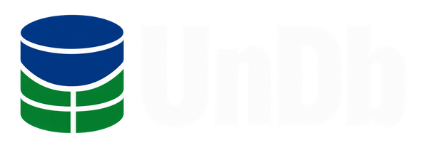
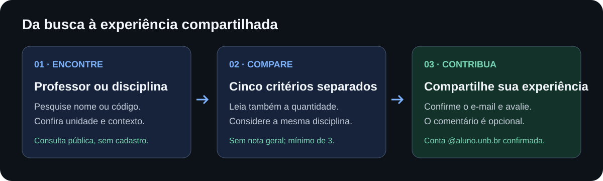
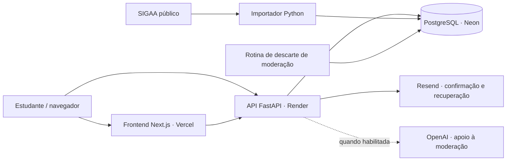

<div align="center">



# Experiências compartilhadas. Escolhas mais informadas.

Encontre professores, explore disciplinas e compare experiências para planejar sua próxima matrícula.

[**Usar o UnDb**](https://undb.app.br) · [Tutorial](docs/tutorial-uso.md) · [Documentação](https://unb-mds.github.io/2026-02-UnDb/) · [Versões](https://github.com/unb-mds/2026-02-UnDb/releases)

[](https://github.com/unb-mds/2026-02-UnDb/actions/workflows/pull-request.yml)
[](https://github.com/unb-mds/2026-02-UnDb/actions/workflows/pages.yml)
[](https://github.com/unb-mds/2026-02-UnDb/releases)


</div>

O UnDb é um projeto acadêmico estudantil independente e sem fins lucrativos, desenvolvido na disciplina de Métodos de
Desenvolvimento de Software da UnB. O catálogo vem de dados públicos do SIGAA;
as avaliações e os comentários são contribuições de estudantes. O serviço é complementar
aos processos oficiais da universidade, sem endosso institucional comprovado.

## Como funciona



1. **Encontre:** pesquise professores, disciplinas ou unidades acadêmicas sem cadastro.
2. **Compare:** leia didática, dificuldade, chamada, material e recomendação para a mesma disciplina, junto da quantidade de avaliações.
3. **Contribua:** confirme seu e-mail `@aluno.unb.br` para avaliar; o comentário é opcional.

Não existe nota geral. Os indicadores detalhados aparecem a partir de três avaliações;
abaixo disso, mostramos contagem e insuficiência. Esse mínimo não condiciona a publicação
de comentários nem garante anonimato. Dificuldade e chamada são informações neutras.
A consulta pública não divulga a conta autora; texto/contexto podem identificar pessoas.
Veja a [metodologia e os limites](https://undb.app.br/sobre#metodologia).

## Documentação para cada público

| Quero… | Começar por |
|---|---|
| Pesquisar, comparar ou avaliar | [Tutorial de uso, passo a passo](docs/tutorial-uso.md) |
| Instalar e subir o ambiente | [Desenvolvimento local](docs/desenvolvimento.md) |
| Entender o código e contribuir | [Entrada para desenvolvedores](docs/para-desenvolvedores.md) e [CONTRIBUTING.md](CONTRIBUTING.md) |
| Trabalhar na interface | [Frontend](frontend/README.md) e [design system](docs/design-system.md) |
| Entender produto e contratos | [Visão](docs/visao.md), [requisitos](docs/requisitos.md) e [specs.md](specs.md) |
| Entender decisões técnicas | [Arquitetura](docs/arquitetura.md) e [ADRs](docs/adrs/index.md) |
| Publicar e operar | [Implantação](docs/implantacao.md), [hospedagem](docs/hospedagem.md) e [operação SIGAA](docs/operacao-importacao-sigaa.md) |
| Entender o apoio de IA | [Implementando com IA](docs/implementando-com-ia.md) e [AI_USAGE.md](AI_USAGE.md) |
| Acompanhar reuniões e entregas | [Atas](docs/atas/README.md), [Issues](https://github.com/unb-mds/2026-02-UnDb/issues) e [board](https://github.com/orgs/unb-mds/projects/60) |

## Arquitetura em uma página



Visão resumida da arquitetura e da hospedagem documentadas; não é um inventário ao vivo
dos serviços. A API concentra regras, autorização e agregação. O frontend não acessa o
banco diretamente. A integração de moderação tem [configuração e limites próprios](docs/moderacao-ia.md),
com revisão humana para sinais/falhas e sem rejeição automática pela IA.

## Executar localmente

Com Docker e Docker Compose instalados:

```bash
git clone https://github.com/unb-mds/2026-02-UnDb.git
cd 2026-02-UnDb
cp backend/.env.example backend/.env
# Configure as credenciais locais e SECRET_KEY antes de iniciar.
docker compose --env-file backend/.env up --build
```

Frontend: `http://localhost:3000` · API: `http://localhost:8000/docs`.
O catálogo depende da importação. O [guia completo](docs/desenvolvimento.md) explica
variáveis, importação, e-mail local e execução com recarga automática. Não versione `.env`.

## Tecnologias e qualidade

| Camada | Tecnologias |
|---|---|
| Interface | Next.js 16, React 19, TypeScript e Tailwind CSS 4 |
| API | Python 3.12, FastAPI e Uvicorn |
| Persistência | PostgreSQL, SQLAlchemy e Alembic |
| Operação | Docker Compose e GitHub Actions |
| Documentação | MkDocs Material e GitHub Pages |

Os workflows verificam lint, tipos, testes, documentação, Compose e jornadas com
PostgreSQL real. Os badges mostram o estado dos workflows indicados; não certificam
produção, disponibilidade contínua ou validação com participantes. Os
[comandos de qualidade](docs/qualidade.md) explicam a execução local e as evidências.

## Versões e acompanhamento

Consulte as [releases](https://github.com/unb-mds/2026-02-UnDb/releases), o
[histórico de mudanças](CHANGELOG.md) e a [reconciliação da R2](docs/releases/2.0.0-reconciliacao.md).
A entrega acadêmica da R2 está prevista para 25/11/2026; versão intermediária de software,
PR aberta e publicação em produção são marcos distintos.

## Quem faz o UnDb

<table><tr>
<td align="center"><a href="https://github.com/nicolaszanin06"><br />Nicolas</a></td>
<td align="center"><a href="https://github.com/ailoiol"><br />Yasmin</a></td>
<td align="center"><a href="https://github.com/ViniGvdo"><br />Vinicius</a></td>
<td align="center"><a href="https://github.com/gabrielrdaraujo"><br />Gabriel</a></td>
<td align="center"><a href="https://github.com/TiagoVieira-596"><br />Tiago</a></td>
<td align="center"><a href="https://github.com/warlleymedeiros"><br />Warlley</a></td>
</tr></table>

Conheça nossos perfis e redes na [página Sobre](https://undb.app.br/sobre).

## Contribuição e licença

Usamos Gitflow: `develop` integra o trabalho e `main` registra releases. Mudanças entram
por PR com verificações e revisão humana, conforme [CONTRIBUTING.md](CONTRIBUTING.md).
Apoio de assistentes/agentes é registrado em [AI_USAGE.md](AI_USAGE.md).

A licença do projeto ainda está em definição; este repositório não declara uma licença de uso.
