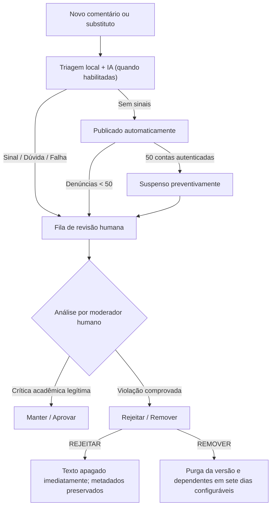

# Canal de solicitações, atendimento a titulares e governança — #263

> **Consolidação das issues #262, #263 e #264 (épico pai #272)**, autorizada pelo PO
> (Nicolas) em 17/11/2026 para execução na Release 2 a partir do head de `develop`.
> Este documento consolida o canal de contato, a disciplina operacional de atendimento aos
> direitos dos titulares da LGPD (#262) e a gestão de revisões da moderação (#264).

---

## 1. Contrato e funcionamento do canal (#263)

O canal está disponível publicamente em `/contato`, com links no rodapé e na página Sobre.
O formulário e o acompanhamento **não exigem login estudantil**, permitindo que docentes,
estudantes e terceiros façam solicitações.

### 1.1 Ciclo de vida da solicitação
1. **Envio sem login:** o solicitante escolhe uma das sete categorias estruturadas:
   - `DADO_INCORRETO`: correção de informações de catálogo (disciplina, professor, vínculo);
   - `COMENTARIO_ILICITO`: contestação de comentários que violem as diretrizes de convivência;
   - `NOTA_SUSPEITA`: relato de anomalias em critérios agregados ou suspeita de manipulação;
   - `FRAUDE_COORDENADA`: relato de tentativas coordenadas de envio de avaliações;
   - `EXPOSICAO_PESSOAL`: relato urgente de dados privados expostos indevidamente;
   - `DIREITO_LGPD`: requisições de confirmação, acesso, correção ou eliminação de dados;
   - `OUTRA`: outras comunicações gerais à equipe.
   Informa a página/identificador do alvo, descrição detalhada (10 a 4.000 caracteres) e evidência textual (até 4.000 caracteres). Não há upload de anexos nem envio de chaves por e-mail.
2. **Geração de protocolo e chave:** o sistema gera um protocolo aleatório (UUID v4) e uma chave secreta de acompanhamento (32 bytes em formato URL-safe). O banco persiste **apenas o hash SHA-256** da chave secreta (`chave_hash`), garantindo que nem mesmo os operadores do banco tenham acesso à chave em claro.
3. **Consulta protegida e complementos:** em `/contato`, informando o protocolo e a chave secreta, o solicitante consulta o andamento e as respostas da equipe. Se desejar acrescentar informações ou requerer revisão manual de decisão, submete um `COMPLEMENTO` (até 4.000 caracteres).
4. **Atendimento interno e separação de histórico:** operadores autorizados acessam `/atendimento`. Os eventos internos do atendimento (`TRIAGEM` e `PROVIDENCIA`) registram o `responsavel_id` e a data/hora, mas **nunca são expostos na consulta pública**. Somente os eventos do tipo `RESPOSTA` e `COMPLEMENTO` compõem a visão pública, e as respostas da equipe omitirão a identificação nominal do operador.

---

As rotas públicas usam o limitador compartilhado no PostgreSQL do Bloco 3 da
#266. Contas usam ID interno; anônimos compartilham capacidade global, sem IP.
Falha suspende o canal público com 503; excesso retorna 429/Retry-After. O antigo
contador por cliente/processo foi removido. Atendimento pela equipe preserva
acessos/autorização e fica fora do limitador. Recebimento segue DESATIVADO.
Consultar [manutenção](operacao/manutencao.md) e
[validações pendentes](seguranca/validacoes-pendentes-266.md) para escala semanal,
substituto, integração futura de contato e condições de ativação. Sem IA no
atendimento. Proxy, logs externos e operação em hospedagem permanecem pendentes
de validação. Nenhuma flag foi ativada por esta entrega.
## 2. Operadores reais, acompanhamento e disponibilidade

O atendimento é manual, realizado pela equipe estudantil voluntária no contexto acadêmico.
**Não há promessa de suporte 24/7, tempo de resposta imediato ou SLA inventado.**

### 2.1 Operadores previstos e papéis

| Nome | Papel no canal | Variável de configuração | Contato de trabalho / identificação | Estado verificado |
|---|---|---|---|---|
| **Nicolas Zanin** | Acompanhamento geral; leitura restrita | `CANAL_TITULARES_LEITORES` | `[A PREENCHER POR NICOLAS: contato de trabalho aprovado]` | Acompanhamento registrado; acesso implantado e disponibilidade atuais não verificados |
| **Tiago Vieira** | Leitura restrita e substituição operacional prevista | `CANAL_TITULARES_LEITORES` | `[A PREENCHER POR NICOLAS: contato de trabalho aprovado]` | Aceite reportado por Nicolas; acesso implantado e escala atual não verificados |
| **Vinicius Gavaldao** | Atendente autorizado previsto | `CANAL_TITULARES_ATENDENTES` | `[A PREENCHER POR NICOLAS: contato de trabalho aprovado]` | Aceite reportado por Nicolas; acesso implantado e disponibilidade atual não verificados |
| **Gabriel** | Atendente autorizado previsto | `CANAL_TITULARES_ATENDENTES` | `[A PREENCHER POR NICOLAS: sobrenome e contato de trabalho aprovado]` | Aceite reportado por Nicolas; acesso implantado e disponibilidade atual não verificados |

> [!IMPORTANT]
> Campos marcados registram informação operacional que Nicolas deve preencher em meio interno. A atribuição e os aceites registrados não comprovam que UUIDs estejam configurados, que a equipe esteja disponível ou que o canal esteja ativo.

### 2.2 Disponibilidade real e urgências
- A disponibilidade/escala efetiva dos atendentes não está registrada no repositório: `[A PREENCHER POR NICOLAS: dias/horários ou janela de disponibilidade acordada e substituto]`. Não há suporte permanente nem SLA novo.
- A equipe disponível recebe urgências pelo próprio canal privado de atendimento da equipe, fora do UnDb: `[A PREENCHER POR NICOLAS: canal privado aprovado e como avisar a equipe disponível]`. Não publicar detalhes de casos ou dados pessoais em issues/PRs. Em `/atendimento`, o atendente registra triagem e providências internas; intervenção em comentário/conta continua sujeita aos papéis e fluxos já autorizados.
- Se o recebimento estiver desativado, novos pedidos não são aceitos; protocolos existentes continuam consultáveis e podem ser atendidos conforme o estado e os controles existentes. Estado de produção não verificado.

### 2.3 Configuração necessária do backend
As variáveis de ambiente devem ser configuradas exclusivamente no ambiente privado do backend:
```dotenv
CANAL_TITULARES_ATIVO=False
CANAL_TITULARES_RETENCAO_APROVADA=False
CANAL_TITULARES_ATENDENTES=<UUID_VINICIUS>,<UUID_GABRIEL>
CANAL_TITULARES_LEITORES=<UUID_NICOLAS>,<UUID_TIAGO>
FLUXOS_ABUSO_MODO=enforce
ABUSO_TITULAR_CRIAR_QUANTIDADE=3
ABUSO_TITULAR_CONSULTAR_QUANTIDADE=10
ABUSO_TITULAR_COMPLEMENTAR_QUANTIDADE=3
```
- `CANAL_TITULARES_ATIVO` e `CANAL_TITULARES_RETENCAO_APROVADA` vêm como `False` por padrão.
- A ativação em produção exige autorização explícita e conferência humana prévia; **não deve ser feita por agentes sem autorização de deploy**.
- As cotas de criação/consulta/complemento são padrões técnicos provisórios do limitador compartilhado da #266, com janela comum configurada por `FLUXOS_ABUSO_JANELA_SEGUNDOS` (padrão 60); falha fecha o canal e excesso responde 429/Retry-After. Configuração atual, versão hospedada e operação não foram verificadas. Não configurar variáveis fora do inventário da versão implantada.

---

## 3. Pedidos de titulares (origem #262 — LGPD)

O UnDb respeita os direitos dos titulares estabelecidos na Lei Geral de Proteção de Dados
Pessoais (Lei nº 13.709/2018), em especial os artigos 18 e 19 (confirmação, acesso, correção,
eliminação, informação sobre compartilhamento).

### 3.1 Verificação proporcional de identidade
Para atender a um pedido sem violar a privacidade de outros usuários ou de avaliadores:
1. **Titular com conta cadastrada:** a identidade é verificada proporcionalmente solicitando que o titular confirme o pedido a partir de seu e-mail institucional `@aluno.unb.br` registrado, ou enviando um código/token temporário ao e-mail cadastrado.
2. **Docente ou terceiro sem conta:** a identidade é conferida por meio de e-mail institucional público informado no SIGAA ou na página oficial da unidade acadêmica da UnB.
3. **Proibição de coleta desproporcional:** é vedado exigir cópia de documento de identidade civil (RG, CNH, CPF), fotos de documentos ou reconhecimento facial para solicitações rotineiras. A exigência de dados deve ser sempre mínima e estritamente necessária ao atendimento.

### 3.2 Distinção entre retirada, desativação e exclusão de conta

A documentação e a equipe distinguem formal e tecnicamente três operações:

| Operação | Escopo e mecanismo | Efeito sobre comentários | Efeito sobre notas/avaliações | Reversibilidade |
|---|---|---|---|---|
| **Retirada de comentário** | Executada somente pelo autor autenticado: `PATCH /api/comentarios/{id}/retirar`. Atendente registra/encaminha; sua allowlist não concede retirada de texto alheio. | O texto sai de exibição pública; denúncias são encerradas como `CONTEUDO_RETIRADO`; estado muda para `RETIRADO`; rotina de purga remove a versão e seus dependentes após sete dias configuráveis. | **Nenhum**. As notas dos 5 critérios estruturados permanecem ativas na base e nos agregados. | Não reversível pelo autor; novo texto exige nova submissão. |
| **Desativação de acesso** | Conceito de bloqueio/revogação; não há operação independente implementada nesta entrega. | Não implica, por si, retirar texto. | Não altera avaliações. | Não há procedimento autônomo definido aqui. |
| **Exclusão de conta (#266, decisão B)** | Exclusão lógica transacional; preserva conta mínima (ID, e-mail reservado, datas e estado), remove nome, senha e papéis, revoga sessões/tokens e agradecimentos. Não reativa por recadastro. | Oculta de imediato versões associadas e encerra denúncias abertas; conteúdo é purgado pela rotina após sete dias configuráveis. | Avaliações são ocultadas dos agregados imediatamente e purgadas após sete dias configuráveis; sem desvinculação das notas. | O acesso é bloqueado; a purga do conteúdo é definitiva. |

### 3.3 Mapeamento de efeitos da exclusão de conta sobre o banco de dados (schema real)

A inspeção do schema real do PostgreSQL/SQLAlchemy revela as seguintes restrições de integridade referencial:

1. **`avaliacoes.usuario_id`:** FK obrigatória (`NOT NULL`, sem `ON DELETE CASCADE`) e unicidade por conta/professor/disciplina. Exclusão lógica preserva o usuário mínimo e o vínculo; avaliações ficam ocultas dos agregados e são purgadas em sete dias configuráveis. Exclusão física direta do usuário não é o fluxo implementado.
2. **`comentario_versoes.avaliacao_id`:** FK obrigatória. Versões são ocultadas/retiradas junto da avaliação e removidas na purga transacional. Denúncias, agradecimentos, decisões e votos vinculados à versão são removidos pela purga explícita antes das versões.
3. **Sessões e tokens** (`sessoes_usuario`, `email_confirmation_tokens`, `password_reset_tokens`): FKs obrigatórias; serviço de exclusão os remove na mesma transação que marca a conta excluída. Links deixam de autenticar.
4. **`votos_comentario`:** FKs para versão e usuário com `ON DELETE CASCADE`; serviço remove todos os votos feitos pela conta na exclusão lógica. Votos de terceiros na versão oculta permanecem até purga da versão, quando também são descartados. Votos não são denúncias.
5. **`decisoes_moderacao.moderador_id`** e **`denuncias.denunciante_id`** aceitam `NULL`; **`agradecimentos.usuario_id`** é obrigatório mas o agradecimento do usuário é removido. **`decisoes_identidade.usuario_id`** é obrigatório: a conta mínima evita quebra dessa referência; não há exclusão física direta.

### 3.4 Limite deliberado: destino das avaliações e encaminhamento ao PO

> **Decisão B (#280), aprovada pelo PO e integrada a develop em 17/11/2026:**
> ao solicitar exclusão de conta, as avaliações e comentários associados são ocultados imediatamente e purgados após sete dias configuráveis. Até a purga, notas continuam vinculadas ao ID preservado da conta mínima e não compõem os agregados públicos. Não apagar ou desvincular notas fora desse fluxo.
>
> A rotina existente implementa exclusão lógica e descarte agendado; não automatiza atendimento completo do pedido, verificação de identidade ou resposta. A conta mínima preserva ID/e-mail/datas/estado; finalidade, prazo e revisão dessa guarda continuam pendentes de validação humana.

### 3.5 Limites reais de backups e restauração
- **O que foi efetivamente realizado:** migração do canal; rotinas de exclusão lógica e purga; ensaio `pg_dump`/`pg_restore` em banco local descartável com dados sintéticos, contagens conferidas e artefatos removidos, conforme evidência da #266. Nesta issue foram acrescentados testes sintéticos para o atendimento e a política; comandos e resultados ficam no relatório de validação do PR.
- **O que é somente procedimento/pendência:** agenda, retenção, permissões, cópias efetivas e restauração em produção, registro mínimo protegido para reaplicar exclusões e comprovação de eliminação em backups. Não foi criado nem inspecionado backup real; Neon/PITR e política de cópias hospedadas não foram confirmados nesta entrega.
- **Limite confirmado:** o ensaio local não informa as características das cópias hospedadas. Cópias de banco não foram verificadas como suportando remoção seletiva individual; não se promete apagamento instantâneo. A reaplicação das exclusões após restauração é procedimento proposto e depende de registro/rotina operacional ainda não validados.

---

## 3.6 Procedimento manual de execução e resposta

1. **Receber e triar:** obter protocolo e referência mínima; registrar categoria, alcance e providência em `TRIAGEM` interna. Nunca pedir senha, cookie ou token de sessão. Não publicar identidade de avaliador nem usar o protocolo como prova de identidade da conta.
2. **Verificar proporcionalmente:** antes de entregar dados privados ou alterar uma conta, conferir controle do contato institucional pelo procedimento humano do item 3.1. O canal não envia códigos de verificação automaticamente; qualquer comunicação externa depende de meio privado e executor autorizados. Sem comprovação suficiente, solicitar complemento e manter a execução pendente.
3. **Executar conforme o tipo e a permissão:**

| Pedido | Executor e fluxo existente | Conferência antes de responder |
|---|---|---|
| Acesso a dados da própria conta | Atendente encaminha a executor técnico com autorização e acesso próprios. Separar apenas os dados do titular; não existe exportador de titulares nesta entrega. Entrega privada depende de destinatário verificado e meio autorizado. | Conferir minimização, destinatário e resultado; não anexar dados de terceiros ao histórico público. |
| Correção cadastral | Após verificação, executor técnico autorizado identifica a conta e corrige o campo aprovado em transação; não há endpoint administrativo de edição nesta entrega. Caso sintético exercita correção do nome, não troca de e-mail ou autoria. Correção de catálogo segue reconciliação própria. | Reler o registro persistido e registrar campo/resultado sem copiar conteúdo sensível ao log. |
| Retirada do texto próprio | Titular autenticado usa `PATCH /api/comentarios/{id}/retirar`; atendente orienta e acompanha, sem se passar pelo autor. | Texto deixa de aparecer; critérios permanecem; denúncias encerram e purga fica agendada. |
| Violação em texto alheio | Atendente encaminha relato fundamentado a moderador elegível. Usar denúncia/triagem e ações existentes em `/moderacao`; uma solicitação de contato não cria denúncia automaticamente. | Conferir decisão, ocultação e notas preservadas; não usar exclusão da avaliação para retirar somente texto. |
| Exclusão de conta | Titular usa `DELETE /api/auth/conta` com sua sessão. Se precisar de execução assistida, encaminhar a executor técnico com acesso e autorização próprios, após identidade conferida; reutilizar a transação de `retencao_service.excluir_conta`, sem apagar usuário diretamente. A allowlist de atendimento não concede esse acesso. | Confirmar credenciais revogadas, conta mínima, ocultação de avaliações/comentários, votos próprios removidos e purga agendada. |

4. **Registrar o resultado:** em `PROVIDENCIA`, registrar referência, executor autorizado, verificação realizada e efeito observado sem segredos; em `RESPOSTA`, explicar o que foi efetivamente executado, prazo configurado de purga e limites de conta mínima/backups. Se execução ou entrega privada não puder ocorrer, informar o encaminhamento pendente em vez de responder “atendido”.
5. **Revisão e urgência:** usar o item 4.4 e os impedimentos; escala, contato privado efetivo e configuração hospedada continuam para confirmação operacional na #168. Ausência desses insumos não é autorização de acesso nem evidência de atendimento real.

---

## 4. Política de moderação e revisão manual (#264)

A moderação no UnDb tem a finalidade exclusiva de preservar um ambiente acadêmico
respeitoso e proteger direitos fundamentais, **sem censurar a crítica acadêmica legítima**.

### 4.1 Critérios objetivos: crítica acadêmica permitida vs. violação



| Categoria | Critério | Exemplos permitidos (Crítica Legítima) | Exemplos proibidos (Violação) |
|---|---|---|---|
| **Didática e Metodologia** | Avaliação sobre a qualidade da explicação, organização e métodos de ensino. | “As explicações foram confusas para mim e o ritmo das aulas foi muito acelerado.” | “Esse professor é burro e incompetente, não sabe nada do que fala.” |
| **Avaliação e Provas** | Opinião sobre grau de exigência, critérios de correção e provas. | “A cobrança na prova foi desproporcional ao conteúdo apresentado em sala de aula.” | “Professor desonesto, persegue alunos e altera notas por vingança pessoal.” |
| **Material e Recursos** | Informação sobre fornecimento de slides, listas e livros. | “O professor não disponibilizou material e os slides continham muitos erros conceituais.” | “Material lixo feito por um parasita.” |
| **Respeito e Convivência** | Relações interpessoais no ambiente universitário. | “O docente foi impaciente ao tirar dúvidas dos alunos durante os plantões.” | Ofensas discriminatórias (raça, gênero, orientação sexual, religião, origem) ou ameaças de qualquer tipo. |
| **Privacidade e Dados** | Menção a informações pessoais. | Menção ao nome público docente constante do SIGAA. | Publicação de telefone, endereço particular, redes pessoais, e-mail pessoal ou dados de alunos. |

### 4.2 Discordância docente e impopularidade
- A discordância de um docente ou da chefia de departamento com uma avaliação desfavorável **não constitui motivo para remoção**.
- Não existe direito de veto institucional ou docente sobre avaliações e comentários respeitosos.
- Turmas com avaliações majoritariamente negativas ou críticas severas permanecem públicas, desde que não incorram nas violações do item 4.1.

### 4.3 Fluxo real de moderação
1. **Triagem automática:** opera em duas camadas quando habilitada:
   - Filtro local em `backend/app/domain/filtro_moderacao.py` (termos léxicos, compatibilidade Unicode, homoglifos e substituições numéricas autorizadas);
   - API de moderação externa (`omni-moderation-latest`), avaliando categorias de violência, assédio e ódio.
   - **Regra de publicação limpa:** o texto só é publicado automaticamente se **ambas as camadas retornarem zero sinais**.
   - **Sem rejeição automática:** qualquer sinal, suspeita de dados pessoais, timeout, erro de rede ou exaustão de cota mantém o comentário no estado `pendente` para revisão humana.
2. **Revisão humana por exceção:** moderadores autorizados avaliam casos pendentes e denunciados em `/moderacao`.
3. **Limiar de 50 contas:** 50 contas autenticadas distintas com denúncias abertas sobre a mesma versão é o gatilho para a suspensão preventiva automática do comentário. **Isso não é um mínimo para atendimento**: uma única denúncia ou solicitação fundamentada basta para análise humana.
4. **Independência das notas:** moderar ou remover um comentário textual **NUNCA altera as notas numéricas** da avaliação nem desfaz o registro estruturado (RF14/RF15).
5. **Votos de utilidade (#278):** votos em comentários são apenas indicadores de relevância comunitária; **não são denúncias**, não alimentam contadores de suspensão e não encaminham o comentário à moderação.

### 4.4 Revisão manual de decisão de moderação
- Solicitantes ou autores de comentários que tiverem seus textos removidos ou rejeitados podem solicitar **revisão manual formal**.
- Quem já tem solicitação consulta com protocolo/chave e envia um `COMPLEMENTO`. Quem ainda não tem protocolo cria uma solicitação em `/contato`, com referência do comentário/decisão e justificativa; a decisão de moderação não gera protocolo de contato automaticamente.
- **Regra de impedimento:** a revisão manual não pode ser julgada pelo moderador que tomou a decisão original nem por quem denunciou o comentário (RF22). Outro moderador elegível analisa o caso; o atendente registra a resposta motivada em `RESPOSTA`. Os papéis são independentes: ser atendente não concede moderação.
- Em versão SUSPENSA, moderador elegível pode usar RESTAURAR. REMOVIDO/REJEITADO não admitem restauração pelo endpoint: a revisão registra a análise e explica o limite, sem recuperar texto apagado. Não contornar o estado com alteração direta do banco. Se não houver executor elegível, registrar o encaminhamento pendente, sem afirmar conclusão.

---

## 5. Resumo para a revisão geral da Release 2 (#168)

Este pacote de entrega consolida:
1. **Canal de contato e solicitações (#263):** funcionalidade integral com proteção por chave, hash no banco, isolamento de notas internas e controle de acesso leitor/atendente.
2. **Disciplina de titulares (#262):** procedimento manual documentado, verificação proporcional, papéis distintos e mapeamento técnico do banco. Destino do conteúdo segue decisão B/#280; guarda mínima continua pendente de validação.
3. **Política de moderação (#264):** diretrizes objetivas de convivência, neutralidade das avaliações e mecanismo de revisão manual de decisões.
4. **Validação automatizada:** suíte de testes com cobertura de integridade estatística, separação de histórico, controle de acesso e quatro casos sintéticos completos.
