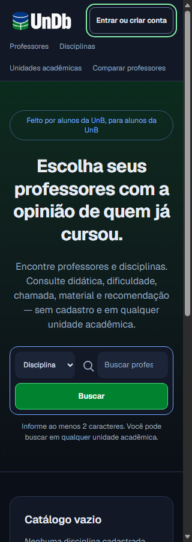

# Cabeçalho conforme a sessão — item da #211

Nicolas solicitou incluir esta correção na mesma PR da reconciliação #207. A mudança
atende somente ao achado do cabeçalho registrado na #211, que continua com seu escopo
de refinamento visual e seus demais critérios independentes.

O cabeçalho exibia Entrar/Criar conta incondicionalmente. Agora consulta a sessão
existente com cookies e `cache: no-store`: uma sessão autenticada mostra somente
**Minha conta**, com acesso a `/login`, onde já existe a gestão da sessão e Sair.
Esse link não recebe `returnTo`, para que a conta possa ser acessada mesmo a partir
de uma avaliação sem redirecionamento imediato de volta ao formulário.

Conforme o refinamento solicitado por Nicolas, visitantes recebem um único botão
**Entrar ou criar conta**, com retorno seguro à avaliação. A mesma chamada permanece
durante a primeira consulta ou uma falha de rede; **Minha conta** só aparece após
validar a sessão. O estado é revalidado após login/logout pelos eventos
já existentes, navegação, foco, restauração da página e retorno à aba. Respostas de
consultas antigas são descartadas. Nenhum cookie é lido pelo JavaScript, não há
estado de autenticação em Web Storage nem cache compartilhado de sessão.

Arquivos: `frontend/src/components/cabecalho.tsx`, serviço `auth.ts` e testes.
Não há alteração de autenticação, permissões, confirmação de e-mail ou backend.

## Verificação

- ESLint, geração de tipos e TypeScript aprovados; 71 testes unitários aprovados.
- Build padrão Next.js/Turbopack aprovado no Docker, com `npm ci` e lockfile.
  Para o navegador local, o build Webpack passou usando as dependências Next.js
  16.3.5/React 19.2.8 já instaladas; Turbopack local recusou a junction para outra
  worktree. A configuração versionada do build não foi alterada.
- `node tests/cabecalho-browser.mjs`: login/logout reais da interface com HTTP
  controlado; recarga/navegação, foco/pageshow, resposta obsoleta, erro/recuperação,
  carregamento neutro, retorno seguro, teclado e ausência de overflow em
  320/768/1280 px, com os dois valores de preferência de tema. A aparência do
  produto permanece no tema dark definido pelo layout.
- O novo runner está incluído em `npm run test:browser` e pode ser executado
  isoladamente com `npm run test:cabecalho`, após o build padrão local.
- Capturas usam somente dados/contas fictícias da fixture, sem credenciais reais.

Esta entrega não encerra a #211 nem substitui reteste com alunos ou implantação.
