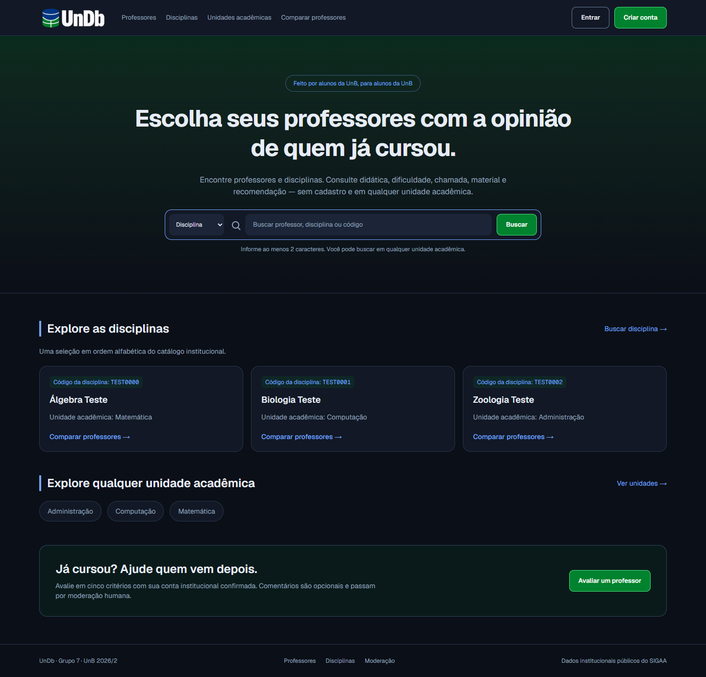
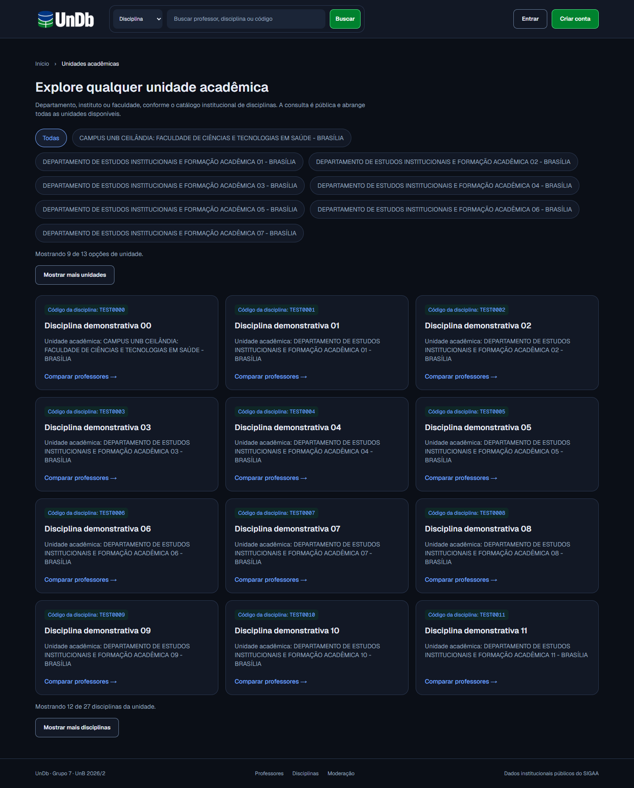

# Identidade, conta e catálogo — PRs #214 e #215

Evidências consolidadas em 10/11/2026 na #167. Capturas produzidas durante as
revisões, em Edge headless no Windows, com HTTP controlado e **dados sintéticos
de teste**. Não mostram o banco Neon, resultados reais ou aceite com alunos.
Larguras em pixels CSS; emulação não equivale a smartphone físico.

| Entrega | Antes | Depois e integração |
|---|---|---|
| #214 / #212 — verde UnB, logo e favicon | `4ed93dd`, revisão da #209 | `73a535b`, merge `ea7c39c` em develop |
| #215 / #205 — conta/avaliação e nomes/expansão | `73a535b`, já com identidade | revisão `85eab6a`, merge `f1f0d00` em develop |

A seleção preserva comparações de home, login, avaliação e unidades em quatro
larguras, copiadas das capturas locais. Evidenciam a apresentação daquela
execução, não cada cenário/estado ou todo ajuste posterior de espaçamento; as
asserções finais também verificaram os alvos de Didática a 320 px. Contratos
vigentes: [identidade](https://github.com/unb-mds/2026-02-UnDb/blob/develop/frontend/docs/ui-dark.md)
e [conta/catálogo](https://github.com/unb-mds/2026-02-UnDb/blob/develop/frontend/docs/ui-conta-avaliacao-205.md).

## Home e identidade — PR #214

| Largura | Antes | Depois |
|---|---|---|
| 320 | [Home](../assets/evidencias/2026-11-10/214-antes-home-320.png) | [Home](../assets/evidencias/2026-11-10/214-depois-home-320.png) |
| 390 | [Home](../assets/evidencias/2026-11-10/214-antes-home-390.png) | [Home](../assets/evidencias/2026-11-10/214-depois-home-390.png) |
| 768 | [Home](../assets/evidencias/2026-11-10/214-antes-home-768.png) | [Home](../assets/evidencias/2026-11-10/214-depois-home-768.png) |
| 1440 | [Home](../assets/evidencias/2026-11-10/214-antes-home-1440.png) | [Home](../assets/evidencias/2026-11-10/214-depois-home-1440.png) |

Verificação da #214: 68 testes unitários de frontend, cobertura, lint, tipos,
build e suítes de navegador aprovados. `identidade-browser.mjs` verifica logo,
ícones ICO/PNG reais, quatro larguras, normal/hover/active/disabled, contraste e
foco. Checks remotos de frontend/backend/Gitflow/Compose e integrações com
PostgreSQL aprovados. Resultados históricos, não reexecutados nesta PR.

## Conta, avaliação e unidades — PR #215

| Tela / largura | Antes | Depois |
|---|---|---|
| Login 320 | [Captura](../assets/evidencias/2026-11-10/215-antes-login-320.png) | [Captura](../assets/evidencias/2026-11-10/215-depois-login-320.png) |
| Login 390 | [Captura](../assets/evidencias/2026-11-10/215-antes-login-390.png) | [Captura](../assets/evidencias/2026-11-10/215-depois-login-390.png) |
| Login 768 | [Captura](../assets/evidencias/2026-11-10/215-antes-login-768.png) | [Captura](../assets/evidencias/2026-11-10/215-depois-login-768.png) |
| Login 1440 | [Captura](../assets/evidencias/2026-11-10/215-antes-login-1440.png) | [Captura](../assets/evidencias/2026-11-10/215-depois-login-1440.png) |
| Avaliação 320 | [Captura](../assets/evidencias/2026-11-10/215-antes-avaliacao-320.png) | [Captura](../assets/evidencias/2026-11-10/215-depois-avaliacao-320.png) |
| Avaliação 390 | [Captura](../assets/evidencias/2026-11-10/215-antes-avaliacao-390.png) | [Captura](../assets/evidencias/2026-11-10/215-depois-avaliacao-390.png) |
| Avaliação 768 | [Captura](../assets/evidencias/2026-11-10/215-antes-avaliacao-768.png) | [Captura](../assets/evidencias/2026-11-10/215-depois-avaliacao-768.png) |
| Avaliação 1440 | [Captura](../assets/evidencias/2026-11-10/215-antes-avaliacao-1440.png) | [Captura](../assets/evidencias/2026-11-10/215-depois-avaliacao-1440.png) |
| Unidades 320 | [Captura](../assets/evidencias/2026-11-10/215-antes-unidades-320.png) | [Captura](../assets/evidencias/2026-11-10/215-depois-unidades-320.png) |
| Unidades 390 | [Captura](../assets/evidencias/2026-11-10/215-antes-unidades-390.png) | [Captura](../assets/evidencias/2026-11-10/215-depois-unidades-390.png) |
| Unidades 768 | [Captura](../assets/evidencias/2026-11-10/215-antes-unidades-768.png) | [Captura](../assets/evidencias/2026-11-10/215-depois-unidades-768.png) |
| Unidades 1440 | [Captura](../assets/evidencias/2026-11-10/215-antes-unidades-1440.png) | [Captura](../assets/evidencias/2026-11-10/215-depois-unidades-1440.png) |

Verificação final da #215: 168 testes de backend, 71 de frontend/cobertura,
Ruff/formatação, ESLint, TypeScript, build e suíte completa de navegador aprovados.
CI remoto também passou, incluindo HTTP/PostgreSQL reais, Compose e Gitflow.
O backend foi testado para correspondência do nome institucional e ausência de
correspondência sem perda de entidades. O cenário controlado de catálogo cobre
expansão 12/24/27, seleção, foco, recarga/histórico e nomes longos.

## Limites e coordenação

- #214/#215 estão em develop e não na tag v1.1.0; a API pública consultada em
  10/11 às 01h01 ainda não expunha `departamento_nome`.
- Nomes vêm da unidade SIGAA; códigos continuam em filtros/identidade. Sem
  migração para “renomear números” e sem reconciliação automática de docentes.
- #204 e #206 mantêm integrações próprias; Yasmin inicia o refinamento final
  #211 após essas entregas. #205 já está integrada/encerrada, #212 encerrada.
- #207 continua responsável pelas identidades provisórias e #166 pelo reteste
  qualitativo; screenshots e testes técnicos não encerram esses escopos.
- Não se declara aprovação da identidade do produto pela UnB. A direção visual
  e a logo vieram do PO; RGB do verde foi conferido no manual oficial.
