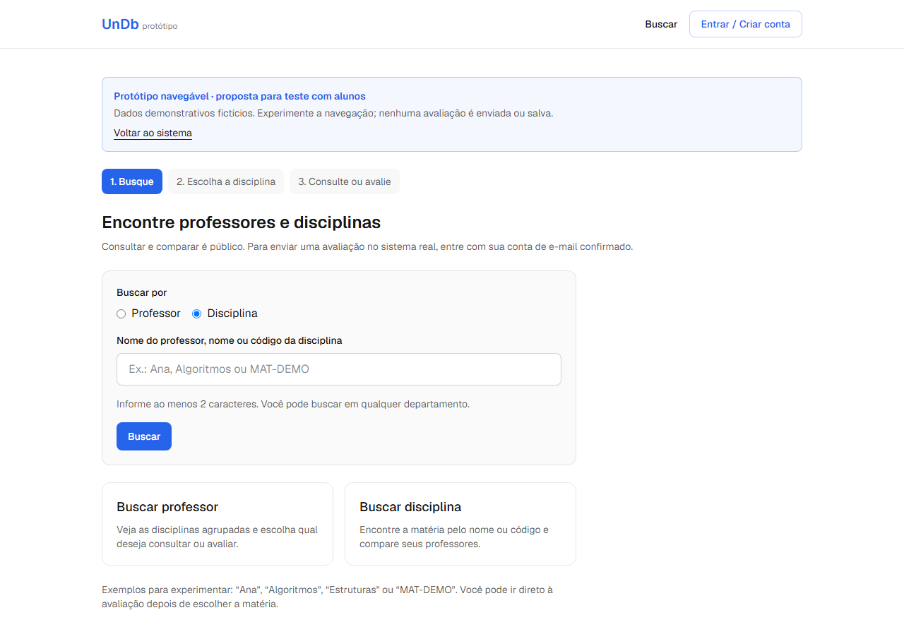
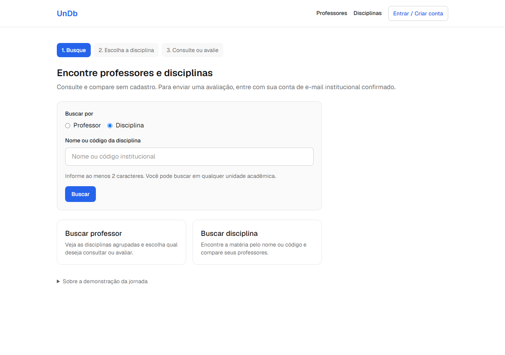

# Integração visual da jornada real — issue #186

## Escopo, aprovação e versões

Análise e implementação relacionadas à [#186](https://github.com/unb-mds/2026-02-UnDb/issues/186)
e à [Epic #144](https://github.com/unb-mds/2026-02-UnDb/issues/144), em 28/10/2026.
O comparativo A1–A7 foi apresentado na conversa antes de alterar código funcional.
O solicitante aprovou explicitamente: **“Aprovo as Propostas, continue a implementação”**.
Esta aprovação abrange o conjunto abaixo e suas exclusões; não autoriza commit,
push, abertura de PR, merge ou encerramento da issue.
Posteriormente, o solicitante autorizou abrir a PR e pediu poucos commits divididos
por assunto. Essa autorização inclui a preparação dos commits e publicação da branch;
o merge continua reservado à revisão e ação humanas.

- Referência visual: **`91ecb79efc1c473624e0adeb358d57eab835da98`**, merge da PR #182.
- Base da aplicação: **`dcff008eb820c094db9506b3b6d988b0053177c6`**, merge da PR #185.
- Implementação: branch `feature/186-integracao-visual`, commits `e249d09` e `97a3215`;
  testes, documentação e evidências preparados em um terceiro commit.
- Git inicial: árvore limpa, inclusive índice e arquivos não rastreados; nenhum
  trabalho local preexistente foi sobrescrito.
- `frontend/src/app/prototipo/`: sem diferenças entre a referência e a base atual.
  Não havia alterações locais não versionadas dessa pasta a adotar.
- Ressalva: o componente compartilhado `criterios-avaliacao.tsx` evoluiu na #158.
  Abrir `/prototipo` na aplicação atual não reproduz integralmente o formulário
  histórico. As capturas de referência abaixo usam os fontes históricos completos,
  incluindo esse componente, e não a renderização atual de `/prototipo`.

As regras são as de [requisitos](../requisitos.md); a solução conserva as fronteiras
de [arquitetura](../arquitetura.md), especialmente ADRs 02/03/05/07/08.
Foram lidos `AGENTS.md`, `CONTRIBUTING.md`, `frontend/AGENTS.md` e as skills
aplicáveis de governança, requisitos, ambiguidades, implementação, frontend,
testing e revisão. Skills propostas foram usadas como orientação sem promoção.

## Entregas existentes verificadas

Foram inspecionados código, histórico, descrições e comentários das issues
#144/#153/#155/#157/#158/#166/#156/#159/#161 e descrições/revisões das PRs abaixo.
Também foi identificada a #186 como issue desta entrega. O status de uma issue
não foi usado isoladamente como comprovação de implementação.

| Entrega | Integração confirmada | Reaproveitamento |
|---|---|---|
| [#153 / PR #182](https://github.com/unb-mds/2026-02-UnDb/pull/182) | Merge `91ecb79`; protótipo e relatório qualitativo | Referência de organização, sem transportar conta/fixtures |
| [#157 / PR #183](https://github.com/unb-mds/2026-02-UnDb/pull/183) | Merge `3c886df9cb960a3585725200024ab31b212c1451`; disciplinas agrupadas, contexto e comparação | `ProfessorResultado`, `DisciplinasProfessor` e rotas de consulta |
| [#158 / PR #184](https://github.com/unb-mds/2026-02-UnDb/pull/184) | Merge `ed9aa0f660d26d33e84fc57bf8d3201f966dafa3`; formulário real e acesso/confirmação/retorno | `AvaliacaoForm`, `CriteriosAvaliacao`, login, cadastro e confirmação |
| [#155 / PR #185](https://github.com/unb-mds/2026-02-UnDb/pull/185) | Merge `dcff008`; contexto por URL, ordenação e navegação integrada | Busca, serviços, helpers de contexto/retorno e senha |

As descrições da Epic e da #155 contêm trechos anteriores à PR #185. O merge e o
código atual confirmam a entrega; não se propôs recriar navegação e ordenação.
O comentário da #153 sobre outra ordenação da comparação não recebeu aprovação
presumida. A ordem vigente permanece.

Fontes de UX: [ajustes da #153](ajustes-prototipo-jornada-issue-153.md),
[resultados e limites do reteste](resultados-reteste-jornada-issue-153.md) e
[diagnóstico #148](observacao-jornada-busca-comparacao.md). RT-01/RT-02 sustentam
retorno, orientação e organização; RT-03/RT-04 sustentam apresentação do formulário
e separação visual do acesso. A direção foi percebida como melhor, mas os ajustes
posteriores ao relato não foram retestados pelo participante.

## Comparativo aprovado por etapa

O “estado real” nesta seção descreve a base `dcff008`, antes desta implementação.
Os critérios são verificações desta solicitação, sem criação de novos RFs.

### A1 — Entrada `/`

1. **Referência:** busca imediata com modalidade, termo e botão; três etapas;
   cartões explicativos abaixo.
2. **Estado real:** título e dois atalhos para páginas de busca; acesso destacado
   à demonstração; nenhuma busca na própria entrada.
3. **Diferença:** falta a organização principal da referência na aplicação normal.
4. **Já atende:** rotas de busca, serviços, helpers de contexto, cabeçalho e tokens.
5. **Adaptação aprovada/implementada:** `BuscaEntrada` encaminha às rotas reais;
   `EtapasJornada` indica o percurso; cartões continuam como apoio. O acesso à
   demonstração fica em seção secundária recolhida, sem remover `/prototipo`.
6. **Justificativa/aceite:** iniciar consulta real por `/` nas duas modalidades;
   encaminhar termo e ordem inicial; seguir a jornada sem visitar `/prototipo`.
7. **Impactos:** rádio nativo em fieldset, rótulos, mínimo de dois caracteres,
   submissão por teclado e formulário GET do Next. Nenhum endpoint novo.

### A2 — Busca e resultados

1. **Referência:** cartões em grade no desktop, unidade/título destacados,
   orientação para escolher e ações hierarquizadas.
2. **Estado real:** coluna única de 672 px com resultados reais, estados,
   ordenação e carregamento independente das disciplinas já implementados.
3. **Diferença:** largura, distribuição, espaçamento e hierarquia dos cartões.
4. **Já atende:** `BuscaInstitucional`, `ProfessorResultado`, serviços e ordenação
   de #155/#157; união de disciplinas por ID antes de ordenar.
5. **Adaptação aprovada/implementada:** contêiner de resultados de 1024 px,
   controles de até 672 px, grade de uma/duas colunas, contexto e ações destacados.
   Links de modalidade também conservam termo e ordem.
6. **Justificativa/aceite:** ler identidade/unidade/disciplinas sem duplicar busca;
   ordenar sem novo HTTP; recuperar contexto em links, histórico e recarga.
7. **Impactos:** DOM mantém ordem de leitura; `aria-live`, debounce e descarte de
   respostas antigas preservados. Contratos atuais são completos, sem paginação.

### A3 — Escolha da disciplina

1. **Referência:** matéria em bloco interno ao professor; código/unidade claros;
   avaliação principal e comparação secundária.
2. **Estado real:** disciplinas e destinos já existem no resultado e no detalhe;
   ações são links de destaque semelhante.
3. **Diferença:** hierarquia visual e orientação da escolha.
4. **Já atende:** único `DisciplinasProfessor`, compartilhado pela busca/detalhe.
5. **Adaptação aprovada/implementada:** superfície interna, espaçamento e avaliação
   como ação preenchida; comparação como ação secundária; consulta preservada.
6. **Justificativa/aceite:** avaliar diretamente sem comparação obrigatória;
   preservar IDs/contexto e manter homônimos separados.
7. **Impactos:** ações quebram linha em 320 px; foco segue a ordem visual. Não há
   mudança em turmas, vínculo institucional ou elegibilidade.

### A4 — Consulta e comparação

1. **Referência:** contexto em cartão, professores em grade, critérios em linhas,
   contagem visível e avaliação evidente.
2. **Estado real:** comparação real em grade; consulta agregada em linhas;
   contexto menos destacado e apresentação distinta dos critérios.
3. **Diferença:** consistência de contexto, critérios e ações.
4. **Já atende:** rotas de disciplina e agregado de professor/disciplina da #157.
5. **Adaptação aprovada/implementada:** contexto destacado e apresentação comum
   `CriteriosAgregados`, extraída das duas telas. Material reúne disponibilidade
   e qualidade em um critério, sem recalcular valores. Ação usa `text-on-accent`.
6. **Justificativa/aceite:** preservar contagem, conflito, ausência/insuficiência,
   ocultação abaixo de três avaliações e ordem retornada pelo backend.
7. **Impactos:** linhas e ações flexíveis, Dificuldade/Chamada neutras e cores dos
   tokens. Turmas ativas e informações institucionais adicionais permanecem.

Não se transportou a ordem arbitrária inicial do protótipo nem seu botão posterior
para ordenar. Comparação real continua por recomendação decrescente, quantidade
decrescente e nome; insuficientes ao final, sem percentual artificial.

### A5 — Formulário de avaliação

1. **Referência:** contexto destacado, cartão delimitando formulário e Didática
   em superfície suave.
2. **Estado real:** botões de Didática sem seleção inicial, texto da escolha,
   grupos de perguntas, respostas explícitas e envio real já existem.
3. **Diferença:** delimitação do formulário e tratamento visual da Didática.
4. **Já atende:** `AvaliacaoForm` e `CriteriosAvaliacao` da #158.
5. **Adaptação aprovada/implementada:** borda/espaçamento do formulário, contexto
   destacado e opção visual `destacarDidatica` apenas no formulário real. Mantidos
   “Sobre as aulas”, “Sua recomendação” e os seletores existentes.
6. **Justificativa/aceite:** mesmos cinco campos/payload; respostas negativas
   preservadas; falha mantém preenchimento; sucesso só após resposta real.
7. **Impactos:** rádios nativos, teclado, foco, campos obrigatórios, estado de
   envio e mensagens existentes preservados. Sem rascunho ou nova escala.

### A6 — Acesso e autenticação

1. **Referência:** cartão com opções de acesso, sem etapas de pesquisa;
   avaliação selecionada em seção expansível recolhida.
2. **Estado real:** rotas separadas, conta única no cabeçalho e Mostrar/Ocultar
   senha; retorno seguro já transportado, sem o cartão de contexto recolhido.
3. **Diferença:** delimitação e apresentação das opções/destino.
4. **Já atende:** login/cadastro, `CampoSenha`, confirmação e validação de retorno.
5. **Adaptação aprovada/implementada:** rotas separadas preservadas, cartão com
   `OpcoesAcesso` e `DestinoAvaliacao` recolhido. Nomes vêm da consulta pública
   existente. Suspense permite apresentar o formulário enquanto carrega o contexto.
6. **Justificativa/aceite:** alternar acesso/cadastro preserva destino; sem etapas
   acima; contexto indisponível informa a falha sem simular dados ou bloquear acesso.
7. **Impactos:** summary com foco visível e consulta auxiliar sem dependência de
   sessão. Nenhuma ampliação de `return_to`, cookie ou permissão.

### A7 — Retorno à avaliação e aos resultados

1. **Referência:** retornos próximos ao conteúdo e com destino compreensível.
2. **Estado real:** #155 já leva contexto por consulta, comparação, avaliação,
   cadastro, confirmação e login, com links aos resultados e à consulta.
3. **Diferença:** consistência visual dos retornos.
4. **Já atende:** `urlBusca`, `comContextoBusca`, `retornoAvaliacaoSeguro` e links.
5. **Adaptação aprovada/implementada:** posição/espaçamento preservados, links de
   retorno em azul e sublinhados; destino e autenticação permanecem os existentes.
6. **Justificativa/aceite:** recuperar termo/modalidade/ordem por link, histórico,
   recarga e acesso; retomar o par correto e voltar aos resultados após enviar.
7. **Impactos:** foco e leitura coerentes. Sem `origem` demonstrativa, novo
   armazenamento ou promessa de preservar respostas depois de sair do formulário.

## Exclusões e contratos preservados

O PO aprovou manter os refinamentos de #158, as duas rotas de acesso, a orientação
fora das telas de autenticação e a comparação real. Não houve conflito novo de
produto que exigisse ampliar a aprovação.

- Preservados RF01–RF15 e RNF02: consulta pública; cadastro enxuto; sessão real;
  confirmação; avaliação única com substituição; cinco escalas; contagens; conflito;
  mínimo de três; agregação e comparação do backend.
- Didática 1–5; Dificuldade Fácil/Médio/Difícil; Chamada/Recomendação booleanas;
  Material nas opções existentes. Sem significados qualitativos novos ou nota geral.
- Contexto continua em URL. `return_to` mantém apenas `busca`, `q`, `ordem`, limite
  de 2.048 caracteres e validações dos dois lados. Sem mudanças em serviços/tipos,
  API, banco, migrations, sessão, dependências ou configuração de build.
- Não transportados: fixtures, conta em memória, confirmação por botão, prévia como
  envio, exploração demonstrativa de estados, ordenação arbitrária e avisos demo.
- #156/#159/#161 seguem com seus escopos. Modelos, schemas e routers da base não
  oferecem contratos integrados de comentários/moderação; nenhuma API foi inventada
  e nenhum comentário pendente foi apresentado como público.
- Sem foto, sala/prédio, perfil editável, histórico pessoal ou rascunhos.

## Rastreabilidade da implementação

| Proposta | Arquivos em `frontend/src/` | Verificação |
|---|---|---|
| A1 | `app/page.tsx`, `components/busca-entrada.tsx`, `components/etapas-jornada.tsx` | Entrada nas duas modalidades, teclado, contexto e matriz real desde `/` |
| A2 | `components/busca-institucional.tsx`, `app/professores/professor-resultado.tsx` | Ordenação sem HTTP, histórico/recarga, grade, erro/recuperação, concorrência |
| A3 | `components/disciplinas-professor.tsx`, `app/professores/[id]/page.tsx` | Homônimos, agrupamento, atalhos, foco e destinos |
| A4 | `components/criterios-agregados.tsx`, `app/disciplinas/[id]/page.tsx`, `app/professores/[id]/disciplinas/[disciplinaId]/page.tsx` | Ordem/desempates, conflito, contagens e ocultação de critérios |
| A5 | `components/criterios-avaliacao.tsx`, `app/professores/[id]/disciplinas/[disciplinaId]/avaliar/{page,avaliacao-form}.tsx` | Sem nota inicial, teclado, respostas Não, rejeição e persistência |
| A6 | `components/{destino-avaliacao,opcoes-acesso}.tsx`, `app/login/{page,login-form}.tsx`, `app/cadastro/{page,cadastro-form}.tsx` | Contexto recolhido, falha auxiliar, sessão, cadastro/confirmação entre abas |
| A7 | Links das rotas acima; helpers da #155 inalterados | Retorno por interface/histórico e após autenticação/envio |

Os Server Components compõem contexto, critérios e navegação. Estado/eventos
permanecem nos Client Components existentes e na escolha de modalidade da entrada.
O novo slot de contexto atravessa a fronteira servidor/cliente como ReactNode;
nenhuma autenticação ou regra de negócio foi transferida ao servidor Next.js.

## Ambiente, testes e resultados

Ambiente Windows; Node.js 24.21.0; Next.js 16.3.5/React 19.2.8 do lockfile; Edge
156.0.4314.50 headless; backend Python 3.12.15 e PostgreSQL 16.15 em containers descartáveis.
API em `127.0.0.1:8000`, frontend real em `localhost:3100`; CORS dessa origem;
e-mail pelo adaptador console previsto para desenvolvimento. Banco `undb186`,
rede `undb-186-net`, containers `undb-186-api`/`undb-186-db`, volume de dados em tmpfs.
Nenhum container preexistente estava ativo na preparação.

Dados reais de transporte/persistência, com registros **sintéticos de teste**;
não representam nova coleta SIGAA, produção ou avaliações de alunos. As suítes
reais não substituem respostas HTTP. Bloqueios de transporte são identificados
como falhas induzidas. A suíte controlada é separada dessa evidência.

| Comando/verificação | Resultado desta execução |
|---|---|
| `npm test` | 26 testes aprovados |
| `npm run lint` | Aprovado |
| `npm run build` | Aprovado com Turbopack padrão e TypeScript |
| `alembic upgrade head` no PostgreSQL descartável | Aprovado até `20260921_01`; sem migration nova |
| `python -m unittest discover -s tests -q` no container isolado | 106 testes aprovados |
| `node tests/acesso-browser.mjs` | 54 combinações aprovadas; duas avaliações verificadas no PostgreSQL; jornada iniciada em `/` |
| `node tests/resultados-browser.mjs` | 72 combinações finais aprovadas; carregamento com latência induzida, vazio, erro/recuperação, comparação e demais estados |
| `npm run test:browser` | Suíte completa aprovada: entrada/modalidades, contexto/histórico/recarga, ordenação sem HTTP, erro/recuperação, falha auxiliar de contexto, acesso, critérios e protótipo (72 combinações históricas da suíte) |
| Build histórico com `npm run build -- --webpack` | Aprovado na cópia isolada da referência |
| `node tests/referencia-browser.mjs` | 48 combinações da referência conferidas, com hashes de todos os fontes e normalização CRLF/LF |
| `git diff --check` | Aprovado nas verificações realizadas |

Falhas intermediárias não foram tratadas como aprovação: o primeiro acesso ao
Docker precisou executar fora da restrição do sandbox; a cópia histórica em temp
não obteve fontes por restrição de rede e a cópia dentro de node_modules falhou
na resolução de aliases. A cópia final em `site/undb-186-reference/` usa fontes
intactos e compilou com acesso às fontes oficiais. A conferência de hashes considera
a conversão CRLF feita pelo Git no Windows, preservando binários.

Na suíte controlada, o novo título compartilhado pela entrada real e pelo protótipo
exigiu esperar o aviso exclusivo da demonstração; a navegação da busca inicial
também passou a esperar o documento correto e a usar digitação pelo navegador.
Uma inconsistência de acentuação em texto novo da comparação foi corrigida antes
das capturas finais. A partida da API em uma repetição exigiu aguardar `/health`
antes das consultas. Nenhum teste de regra foi removido ou enfraquecido.

### Reprodução das verificações

1. Gerar o build real em `frontend/`. Subir PostgreSQL vazio e API isolados com o
   código desta árvore montado somente para leitura; aplicar migrations.
2. Gerar `RESULTADOS_FIXTURE_FILE` com `UNDB_INTEGRATION_TEST=1 python -m tests.seed_resultados`.
   Executar `node tests/resultados-browser.mjs` com `PREVIEW_DIR` próprio.
3. Gerar `E2E_ACESSO_FIXTURE_FILE` com `python -m tests.integration_acesso --prepare`.
   Usar `E2E_ACESSO_CONTAINER=undb-186-api` e `PREVIEW_DIR` próprio; executar
   `node tests/acesso-browser.mjs`. O runner lê os links console e inspeciona o banco.
4. Parar somente a API do teste antes de `npm run test:browser`: essa suíte reserva
   8000/3100/9223 e usa respostas controladas. As suítes reais usam 3100/9224 ou 9225.
5. Para a referência, extrair `git archive 91ecb79efc1c473624e0adeb358d57eab835da98 frontend`
   em diretório isolado. Usar dependências do lockfile (inalterado entre as versões),
   gerar o build e definir `PROTOTIPO_REFERENCE_DIR` para seu frontend.
   `node tests/referencia-browser.mjs`, com `PREVIEW_DIR` próprio, reserva 3102/9226,
   recusa fontes divergentes e captura o protótipo histórico.

### Evidências comparativas

Referência histórica: fixtures demonstrativas, **não** evidência de persistência.
Aplicação integrada: chamadas FastAPI e PostgreSQL reais com dados sintéticos
persistidos. Os dados não são iguais entre as colunas; compara-se a organização.

| Etapa | Protótipo histórico, 1280 claro | Aplicação integrada, 1280 claro |
|---|---|---|
| Entrada | [Referência](evidencias/issue-186/referencia/entrada-light-1280.png) | [Rota `/`](evidencias/issue-186/acesso/entrada-light-1280.png) |
| Resultados por professor | [Referência](evidencias/issue-186/referencia/resultados-professores-light-1280.png) | [Busca real](evidencias/issue-186/resultados/busca-professores-light-1280.png) |
| Resultados por disciplina | [Referência](evidencias/issue-186/referencia/resultados-disciplinas-light-1280.png) | [Busca real](evidencias/issue-186/resultados/busca-disciplinas-light-1280.png) |
| Escolha | [Referência](evidencias/issue-186/referencia/escolha-light-1280.png) | [Detalhe real](evidencias/issue-186/resultados/detalhe-professor-light-1280.png) |
| Comparação | [Referência](evidencias/issue-186/referencia/comparacao-light-1280.png) | [Comparação real](evidencias/issue-186/resultados/comparacao-light-1280.png) |
| Formulário | [Referência](evidencias/issue-186/referencia/formulario-light-1280.png) | [Formulário real](evidencias/issue-186/acesso/formulario-light-1280.png) |
| Acesso | [Referência](evidencias/issue-186/referencia/acesso-light-1280.png) | [Login](evidencias/issue-186/acesso/login-light-1280.png) / [Cadastro](evidencias/issue-186/acesso/cadastro-light-1280.png) |

Exemplo visual da entrada, referência e aplicação:

Também foram produzidos pares em **320 px escuro** nos mesmos diretórios.
[Formulário real móvel](evidencias/issue-186/acesso/formulario-dark-320.png),
[login móvel](evidencias/issue-186/acesso/login-dark-320.png),
[confirmação](evidencias/issue-186/acesso/confirmacao-dark-320.png),
[rejeição por e-mail pendente](evidencias/issue-186/acesso/email-pendente-dark-320.png),
[sucesso persistido](evidencias/issue-186/acesso/sucesso-light-1280.png),
[insuficiência](evidencias/issue-186/resultados/insuficiente-dark-320.png) e
[zero avaliações](evidencias/issue-186/resultados/sem-avaliacoes-dark-320.png)
registram os estados adicionais.

Estados de busca com os serviços reais: [inicial](evidencias/issue-186/resultados/busca-inicial-light-1280.png),
[carregamento](evidencias/issue-186/resultados/busca-carregando-dark-320.png),
[vazio](evidencias/issue-186/resultados/busca-vazia-light-1280.png) e
[erro](evidencias/issue-186/resultados/busca-erro-dark-320.png). Carregamento usa
latência de rede induzida; erro usa bloqueio de transporte no navegador, com
recuperação conferida após remover o bloqueio. Não são respostas HTTP simuladas.

Manifestos: [acesso real](evidencias/issue-186/acesso/resultado.json),
[resultados reais](evidencias/issue-186/resultados/resultado.json) e
[referência](evidencias/issue-186/referencia/resultado.json).
O [manifesto da versão](evidencias/issue-186/versao.json) identifica base, branch,
ambiente e hashes SHA-256 dos 50 arquivos de `frontend/src/`, com normalização de
fim de linha nos fontes textuais. O hash do conjunto é
`bdeda8a0861d2cf357b9cec2d37de8e543c49056c34e8f47015df3cd0ad9ff73`.
Capturas em `controlado/` são exclusivamente testes com respostas controladas;
não devem ser apresentadas como funcionamento da API/PostgreSQL.

São 42 capturas de telas/estados reais, 16 da referência histórica e 45 da suíte
controlada. Foram inspecionadas amostras de entrada, busca agrupada, consulta/
comparação, formulário, acesso, sucesso, carregamento e erro em desktop e celular.
As capturas de acesso controlado limpam a senha sintética antes de gravar a imagem.
As matrizes conferem ausência de transbordamento em 320/768/1280 px, um h1 por tela,
grade, foco, teclado e rótulos conforme os cenários dos runners. Isso não representa
uma certificação geral de acessibilidade nem teste com leitor de tela.

## Encaminhamento ao reteste #166 e limites

A validação técnica não é reteste qualitativo. A #166 deve usar esta versão
integrada, sem acessar `/prototipo`, e repetir busca, distinção de professor/unidade,
escolha, comparação, avaliação/acesso e retorno. Registrar participante anônimo,
contato prévio, ajuda, tarefas/resultados, data, dispositivo/navegador e versão.
Conferir os itens não confirmados da #153: termo no retorno/histórico, homônimos e
códigos, percurso até avaliar, Chamada/Recomendação e confirmação de e-mail.

Nesta execução não houve alunos, dispositivo físico, leitor de tela, envio a caixa
postal externa ou coleta SIGAA. Viewport móvel foi emulado. O adaptador console
valida o fluxo real de desenvolvimento; entrega externa segue na #165. A ordenação
local continua válida para o contrato completo atual, não para paginação futura.
`python -m mkdocs --version` informou módulo ausente; o build de documentação não
foi executado. Links locais e o item adicionado ao `mkdocs.yml` foram conferidos.

## Git e preparação da PR

Na conclusão técnica inicial não havia commit, push ou PR. Após autorização
explícita do solicitante para abrir a PR, o trabalho foi dividido em três unidades:

1. `e249d0909ea54a0fd200a2535f15b6221fc9b597` — entrada, busca, escolha e consulta/comparação.
2. `97a32159601bf3159426cad8df431f4ca4bd9483` — formulário e apresentação do acesso.
3. Testes, documentação e evidências — commit separado que contém este relatório.

O commit `97a3215` contém todos os fontes de aplicação capturados e testados;
seus hashes conferem com o manifesto das evidências. A base continua `dcff008`.
A publicação autorizada usa a branch `feature/186-integracao-visual` e destino
`develop`. Não há autorização para merge ou encerramento manual de issue.
A revisão local do diff e dos arquivos novos
confirmou o escopo A1–A7, sem alteração de backend, contratos ou dependências;
não substitui revisão humana. Containers e rede descartáveis da execução foram
removidos ao terminar; serviços de outras tarefas não foram alterados.

Título sugerido: **`feat(ux): integrar visual do protótipo à jornada real`**.

Descrição preparada para a PR autorizada:

> Integra a apresentação aprovada do protótipo à jornada real desde `/`, com busca
> inicial, orientação por etapas, resultados em grade, ações de avaliação destacadas,
> critérios consistentes e contexto recolhido no acesso. Reutiliza #155/#157/#158 e
> preserva serviços, contratos, autenticação, persistência e regras de produto.
>
> Comparativo A1–A7 aprovado pelo solicitante em 28/10/2026, com referência `91ecb79`.
> Evidências e comandos neste relatório. Dados sintéticos persistidos, viewport
> móvel emulado e e-mail console; reteste com alunos permanece na #166.
>
> Relacionada à #186 e à Epic #144. Aguardar checks e revisão humana para integração.
