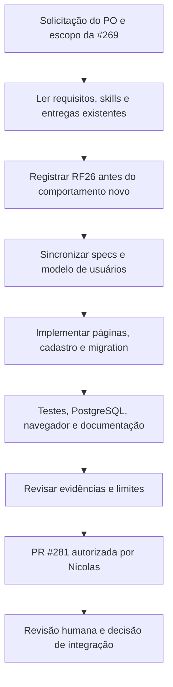

# Implementando com IA

Este documento descreve como o UnDb organiza o trabalho assistido por IA com requisitos,
especificação, skills, implementação e verificação. As fontes canônicas continuam nos
arquivos referenciados; esta explicação não cria novas regras nem promove propostas.
O uso efetivamente identificado está no [registro de IA](uso-ia.md).

## Um pedido começa com fonte e escopo

Uma tarefa parte de uma solicitação humana e da issue correspondente. O agente verifica
`AGENTS.md`, identifica a skill pela descrição e lê seu `SKILL.md` integral e referências
necessárias. O bootstrap aponta para `skills/`; instruções universais do projeto não
ficam dependentes de uma única ferramenta.

| Fonte | Papel no fluxo |
|---|---|
| [Requisitos](requisitos.md) | Comportamento de produto, origem das decisões e critérios de aceite |
| [Arquitetura e ADRs](arquitetura.md) | Decisões estruturais, estados e restrições já registradas |
| `specs.md`, na raiz | Especificação derivada de requisitos/arquitetura, contratos e detalhes de implementação |
| `skills/`, na raiz | Procedimentos por responsabilidade e tecnologia, com estado próprio |
| Issue e PR | Escopo da tarefa, histórico da entrega, revisão e evidências |
| Código e testes | Estado construído e mecanismos de verificação; não criam requisito por existirem |

Quando muda comportamento autorizado, a fonte de requisitos é atualizada antes dos
contratos derivados e da implementação. Mudanças documentais, como as atas da #241,
registram fatos sem transformar contexto de issues em nova decisão de produto.

## As skills dividem responsabilidades

A árvore atual separa governança, processo, engenharia e tecnologia. Por exemplo,
`requirements` estrutura requisitos; `implementation` executa mudança autorizada;
`testing` verifica comportamento; `code-review` identifica problemas com evidência;
`meeting-minutes` registra reuniões; e `project-governance` delimita autoridade.

Cada arquivo tem estado explícito. A existência de uma skill proposta não a torna uma
regra oficialmente aprovada. O inventário e as explicações históricas estão em
[Agent Skills](https://github.com/unb-mds/2026-02-UnDb/blob/develop/docs/agent-skills.md); os arquivos atuais em `skills/` são a referência a conferir.
Não se presume que toda skill ou ferramenta tenha sido usada por todos os integrantes.

## Exemplo concreto: Issue #269

Nicolas solicitou inventário, Política de Privacidade, Termos e ciência no cadastro,
incluindo “sem fins lucrativos”. O trabalho assistido nesta sessão seguiu este percurso:

O código foi preparado em uma worktree isolada para preservar alterações existentes.
A ciência não foi atribuída retroativamente a contas antigas. Fatos não confirmados de
backups, fornecedores e atendimento foram apresentados como limites, em vez de promessas.
Nicolas autorizou um commit e a abertura da [PR #281](https://github.com/unb-mds/2026-02-UnDb/pull/281).
A PR foi integrada em 17/11/2026, conforme GitHub consultado nesta sessão. Essa
integração não comprova deploy.

## Como revisar o que a IA produz

A revisão confronta o diff e a implementação com a fonte autorizada. Testes precisam
verificar o comportamento esperado e falhas relevantes, não apenas repetir a estrutura
do código. Resultados são relatados com versão, ambiente e limitações; testes com HTTP
controlado são distintos de integração com API/PostgreSQL reais e de observação com alunos.

O desenvolvimento mantém segredos e dados reais fora de prompts, dumps e evidências
públicas. Sugestões de biblioteca, requisito, arquitetura ou acesso não se tornam decisões
por terem sido geradas. Aprovações e operações Git seguem as skills canônicas e o
[guia de contribuição](https://github.com/unb-mds/2026-02-UnDb/blob/develop/CONTRIBUTING.md).

## Registro, limites e aprendizado

O registro de IA informa objetivo, ferramenta/modelo conhecido, artefato e o que foi
aceito/ajustado/rejeitado. Exemplos desta sessão: datas de reuniões não foram deduzidas
de segundas/quartas; as presenças foram corrigidas pelo relato de Nicolas; e referências
históricas do backlog foram separadas de atas e compromissos individuais.

A documentação permite explicar o trabalho, mas não comprova entendimento individual
de cada integrante. Nesta consolidação não se mede percentual de autoria por IA nem
se reconstrói todo o histórico sem fonte.

## Desenvolvimento assistido e moderação são usos distintos

Assistentes ajudam a produzir/revisar software. A [moderação com IA](moderacao-ia.md)
é uma funcionalidade do produto, com configuração, limites e revisão humana próprios.
A documentação dessa funcionalidade não substitui a declaração do uso de assistentes
no desenvolvimento.
