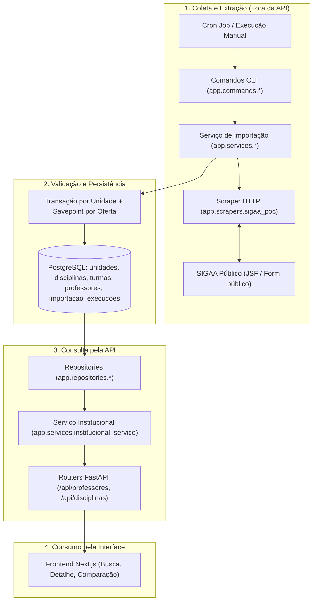

# Importação persistida do SIGAA

Este procedimento integra a coleta HTTP validada na Issue #23 à persistência da Issue #25 e à operação da Issue #26.
A importação roda fora da API: nenhum endpoint consulta o SIGAA em tempo real.

## Visão geral fim a fim

O fluxo de dados da integração SIGAA opera em desacoplamento estrito entre coleta/gravação e consumo:



### Mapeamento dos componentes por etapa

| Etapa | Módulo / Componente | Responsabilidade técnica |
|---|---|---|
| **Disparo / Agendamento** | `scripts/cron/sigaa-import.sh` e cron do SO | Valida ambiente, orquestra execução periódica e define perfil de agendamento (diário/semanal). |
| **Comando / CLI** | `app.commands.importar_sigaa_agendado` e `app.commands.importar_sigaa` | Ponto de entrada CLI, faz parse dos argumentos (`--todas-unidades` ou `--departamento`), formata saída JSON e define código de saída (`0` ou `1`). |
| **Orquestração e Histórico** | `app.services.importacao_agendada_service` | Registra e atualiza a auditoria em `importacao_execucoes` (`status`, contadores, erros, JSON). |
| **Extração e Sincronização** | `app.services.sigaa_import_service` | Orquestra tentativas de requisição HTTP, isolamento transacional por unidade e savepoints por oferta (`salvar_oferta`). |
| **Scraper HTTP público** | `app.scrapers.sigaa_poc` | Faz requisições HTTP (com `CookieJar`), extrai `javax.faces.ViewState`, submete formulário e faz parse HTML do resultado das turmas (`parse_ofertas`). |
| **Persistência relacional** | `app.repositories.*` e PostgreSQL | Persiste entidades relacionais (`Unidade`, `Disciplina`, `Turma`, `Professor` e vínculos `turmas_professores`) e inativa ofertas ausentes em coletas íntegras. |
| **Leitura e Exposição** | `app.services.institucional_service` e `app.routers.{professores,disciplinas}` | Disponibiliza listagem e detalhe de professores, disciplinas e turmas ativas sem consultar o SIGAA em tempo real. |
| **Consumo no Cliente** | `frontend/src/lib/services/{professores,disciplinas}.ts` | Consome a API pública para alimentar páginas de busca, detalhe de professor e comparação de disciplinas. |

## Pré-requisitos

1. Configure `backend/.env` a partir de `backend/.env.example`.
2. Garanta que o PostgreSQL indicado por `DATABASE_URL` esteja acessível.
3. Aplique as migrações com `alembic upgrade head`.
4. Execute os comandos abaixo a partir de `backend/`.

## Executar

A importação pode ser executada por dois comandos com propósitos complementares:
- `app.commands.importar_sigaa_agendado`: recomendado para produção, cron e testes de auditoria, pois registra a execução na tabela `importacao_execucoes` e suporta `--todas-unidades`;
- `app.commands.importar_sigaa`: comando pontual voltado para execução direta de um ou mais departamentos específicos, sem registrar na tabela de histórico.

### Execução de departamentos específicos

Cada `--departamento` usa o formato `CODIGO=ROTULO_SIGAA`. A opção pode ser repetida;
uma falha de coleta ou persistência em uma unidade não impede a execução das seguintes.

```bash
python -m app.commands.importar_sigaa \
  --departamento "CIC=DEPTO CIÊNCIAS DA COMPUTAÇÃO" \
  --ano 2026 \
  --periodo 2
```

Exemplo com mais de uma unidade:

```bash
python -m app.commands.importar_sigaa \
  --departamento "CIC=DEPTO CIÊNCIAS DA COMPUTAÇÃO" \
  --departamento "MAT=DEPTO MATEMÁTICA" \
  --ano 2026 \
  --periodo 2
```

O rótulo deve identificar uma opção atual do formulário público do SIGAA. Para a enumeração automática de todas as unidades, utilize o comando agendado documentado em [`operacao-importacao-sigaa.md`](operacao-importacao-sigaa.md).

## Contrato de resultado e fluxo de dados

Depois que a configuração é carregada e a execução iniciada, o comando imprime JSON estruturado. O campo
de execução `sucesso` é `true` somente quando todas
as unidades terminam sem erro. Cada item de `departamentos` contém:

- `sucesso`: booleano indicando o resultado daquela unidade específica;
- `total_reportado`: total de ofertas informado pelo rodapé da tabela pública do SIGAA;
- `ofertas_extraidas`: quantidade de ofertas identificadas no HTML parseado;
- `ofertas_processadas`: quantidade de ofertas persistidas ou atualizadas no banco (inclui registros já existentes que foram reutilizados na reimportação);
- `estado`: classificação do departamento (`sucesso`, `parcial` ou `falha`);
- `erros`: lista de mensagens de erro capturadas (divergência de contagem, falha de requisição, erro de parsing ou falha de banco).

O código de saída é `0` para sucesso integral e `1` quando existe qualquer falha. Scripts e rotinas
automatizadas podem armazenar o JSON e usar o código de saída para monitoramento, sem precisar
interpretar texto livre.

## Semântica da sincronização e regras de negócio

- **Ofertas sem docente e multidocentes:** ofertas sem docente são persistidas com zero vínculos; ofertas com múltiplos docentes preservam todos os vínculos em `turmas_professores`.
- **Identidades docentes provisórias:** como a página pública não fornece SIAPE, cada docente recebe identidade provisória associada à sua ocorrência de turma (`SIGAA:UNIDADE:PERIODO:COMPONENTE:TURMA:NOME_NORMALIZADO`). Homônimos não são unidos silenciosamente e uma reconciliação futura pode confirmar a identidade definitiva.
- **Identificação da turma:** a turma é identificada pela combinação de fonte (`SIGAA`), unidade, disciplina, período e código textual da turma. Uma alteração de docente atualiza os vínculos sem duplicar a turma no banco.
- **Tratamento de turmas ausentes (inativação):** somente uma coleta completa da unidade, com a contagem validada contra o rodapé do SIGAA e sem nenhum erro em ofertas individuais, marca como inativas (`ativa=false`) as turmas ausentes. Em uma execução parcial, as ofertas válidas são persistidas ou atualizadas, inclusive seus vínculos docentes, mas as turmas ausentes não são inativadas. Se o commit da unidade falhar, a transação é desfeita e as alterações dessa unidade não são persistidas.
- **Isolamento da API:** falhas de importação não afetam a disponibilidade da API HTTP nem interrompem consultas de usuários, pois o processo é completamente desacoplado e executado fora do ciclo de vida dos endpoints.

## Verificações e exemplo reproduzível

Para fins de testes, desenvolvimento e auditoria por avaliadores, é fundamental diferenciar os três tipos de verificação disponíveis:

| Modo de verificação | Dependência externa | Modifica banco real? | Finalidade |
|---|---|---|---|
| **Teste determinístico integrado** | Nenhuma (HTML mock / SQLite em memória) | Não | Valida o fluxo completo de ponta a ponta: extração HTML → persistência relacional → consulta pela API FastAPI. |
| **Consulta pública somente leitura** | SIGAA público (conectividade HTTP) | Não | Valida a resposta do formulário público JSF e o parser de ofertas sem persistir no banco. |
| **Execução persistida real** | SIGAA público + PostgreSQL configurado | Sim | Atualiza os dados de produção/desenvolvimento via comando agendado ou manual. |

### Exemplo reproduzível independente de credenciais e do SIGAA

Para validar que o pipeline de extração, persistência e leitura pela API funciona de forma consistente sem depender de conexão com o SIGAA ou de credenciais de banco:

1. **Executar o teste do fluxo integrado:**
   A partir de `backend/` (ou via container Docker):
   ```bash
   python -m unittest tests/test_fluxo_sigaa_integrado.py -v
   ```
   **O que este teste valida:**
   - Realiza o parse real do HTML (`HTML_EXEMPLO_REAL`) de turmas obtido da fonte pública usando `app.scrapers.sigaa_poc.parse_ofertas`;
   - Persiste a oferta (`salvar_oferta`), criando a `Unidade`, `Disciplina`, `Turma` e o `Professor` provisório em um banco SQLite em memória;
   - Invoca a função do router da API (`consultar_avaliacoes_professor_disciplina`), demonstrando que o registro gravado fica imediatamente disponível para a camada de consumo;
   - Valida que o total de avaliações inicia em 0 sem corromper contratos.

   **O que este teste não valida:**
   - Não valida a latência, cookies JSF ou estabilidade de rede da infraestrutura da UnB;
   - Não valida a concorrência do cron em produção.

2. **Executar a suíte de testes do importador agendado:**
   ```bash
   python -m unittest tests/test_importacao_agendada_service.py -v
   ```
   Valida o isolamento de erros, gravação de status `em_andamento` -> `sucesso`/`falha`, contadores e captura de exceções em `importacao_execucoes`.

3. **Verificação determinística manual via script Python (passo a passo reproduzível):**
   ```python
   # Executável em qualquer ambiente Python 3.12:
   from sqlalchemy import create_engine, select
   from sqlalchemy.orm import Session
   from app.core.database import Base
   from app.models import Disciplina, Professor
   from app.scrapers.sigaa_poc import parse_ofertas
   from app.services.sigaa_import_service import salvar_oferta

   engine = create_engine("sqlite+pysqlite:///:memory:")
   Base.metadata.create_all(engine)

   html = '''<table><tbody>
     <tr class="agrupador"><td><a onclick="jsfcljs({'id':'177942'})">
       <span class="tituloDisciplina">CIC0002 - FUNDAMENTOS TEÓRICOS DA COMPUTAÇÃO</span>
     </a></td></tr>
     <tr class="linhaPar">
       <td class="turma">01</td><td class="anoPeriodo">2026.2</td>
       <td class="nome">MARIA EMILIA MACHADO TELLES WALTER (60h)</td>
     </tr>
   </tbody><tfoot><tr><td><b>1 turmas encontrada(s)</b></td></tr></tfoot></table>'''

   ofertas, total = parse_ofertas(html)
   with Session(engine) as session:
       salvar_oferta(session, ofertas[0], "CIC")
       session.commit()
       prof = session.scalar(select(Professor))
       disc = session.scalar(select(Disciplina))
       print(f"Importado com sucesso: {prof.nome} leciona {disc.codigo} - {disc.nome}")
   ```

### Consulta manual à fonte pública (somente leitura)

Caso deseje testar a comunicação de rede direta com a página do SIGAA sem gravar dados:

```bash
python -m app.scrapers.sigaa_poc --real
```

### Execução persistida real contra o PostgreSQL

A execução real completa utiliza o comando agendado (ou o script do cron) com o PostgreSQL configurado:

```bash
python -m app.commands.importar_sigaa_agendado \
  --departamento "CIC=DEPTO CIÊNCIAS DA COMPUTAÇÃO" \
  --ano 2026 \
  --periodo 2
```

Para a inspeção do histórico gravado, consulte os comandos em [`operacao-importacao-sigaa.md`](operacao-importacao-sigaa.md).

### Evidências executadas em 17 e 18/09/2026

A consulta pública real do CIC em 2026.2 reportou e extraiu 108 ofertas. A composição observada
foi de 98 ofertas com exatamente um docente, nove com dois e uma com três, totalizando 119
vínculos, 57 disciplinas e 119 identidades docentes provisórias. O modelo atual identifica a
turma pela origem, unidade, período, disciplina e código textual da turma, preservando todos os
docentes associados às dez ofertas multidocentes.

Em 17/09/2026, a validação de conclusão da Issue #25 executou duas importações consecutivas dos
dados reais no mesmo PostgreSQL 16. As duas execuções retornaram 108 ofertas e mantiveram as
contagens estáveis em uma unidade, 57 disciplinas, 108 turmas, 119 docentes provisórios e 119
vínculos, sem duplicatas. A migração dos dados legados e uma consulta pela API também foram
validadas nessa execução.

Em 18/09/2026, a fonte e o comportamento determinístico foram revalidados sem alterar o banco
do projeto:

- a POC consultou novamente o SIGAA público e obteve `total_reportado=108` e
  `ofertas_extraidas=108` para CIC em 2026.2;
- a suíte backend completa passou com 51 testes;
- a primeira oferta extraída continuou sendo o componente `CIC0002`.

A checagem de 18/09 é somente leitura e complementa, sem substituir, a evidência de
persistência e idempotência em PostgreSQL registrada em 17/09 na Issue #25.

### Evidência operacional recebida em 20/09/2026

Antes da integração da implementação atual da Issue #26 em `develop`, duas execuções
manuais consecutivas do script disponível naquela revisão simularam o disparo pelo cron:

| Execução | Início (UTC) | Fim (UTC) | Ofertas extraídas | Ofertas processadas | Erros de oferta |
|---|---|---|---|---|---|
| 1 | 15:41:08 | 15:41:13 | 108 | 98 | 10 |
| 2 | 15:45:07 | 15:45:11 | 108 | 98 | 10 |

As duas execuções terminaram e mantiveram estáveis as contagens observadas naquela revisão:
46 professores, 51 disciplinas e 83 turmas. Isso fornece evidência de repetibilidade e de
ausência de duplicação para o cenário executado, mas não representa sucesso integral segundo
o contrato atual, pois cada execução registrou dez erros de oferta.

Os erros ocorreram na revisão anterior para ofertas com múltiplos docentes. Eles não descrevem
uma limitação do modelo vigente: a modelagem aprovada e o serviço atual preservam zero, um ou
vários vínculos docentes por turma. A evidência atual de persistência integral de 108 ofertas
está registrada acima, nas validações de 17 e 18/09/2026.

Para executar a importação com registro consultável e integrá-la a um agendador, consulte
[`operacao-importacao-sigaa.md`](operacao-importacao-sigaa.md).
