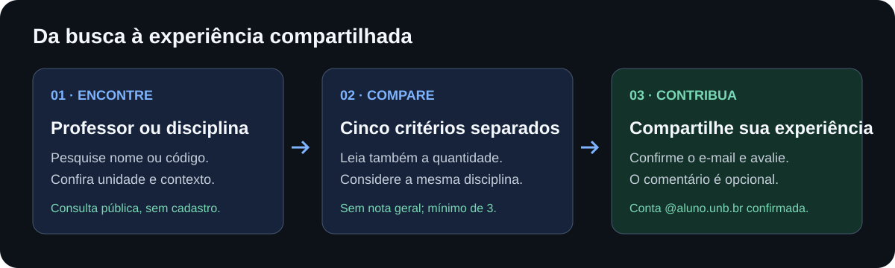

# UnDb

## Informação para escolher melhor

O **UnDb** é uma aplicação web para consulta e avaliação de professores e disciplinas
da Universidade de Brasília. O projeto transforma relatos dispersos em resultados
estruturados e comparáveis, com dados institucionais provenientes de páginas públicas do
SIGAA.

-   :material-target:{ .lg .middle } **Visão do produto**

    ---

    Entenda o problema, o público, a proposta de valor, os limites e as releases.

    [:octicons-arrow-right-24: Ler a visão](visao.md)

-   :material-clipboard-check-outline:{ .lg .middle } **Requisitos**

    ---

    Consulte os requisitos funcionais e não funcionais, suas regras e rastreabilidade.

    [:octicons-arrow-right-24: Explorar requisitos](requisitos.md)

-   :material-sitemap-outline:{ .lg .middle } **Arquitetura**

    ---

    Veja componentes, camadas, modelo de dados, fluxos, ADRs e riscos técnicos.

    [:octicons-arrow-right-24: Ver arquitetura](arquitetura.md)

-   :material-vector-square:{ .lg .middle } **Board no Figma**

    ---

    Navegue pela pesquisa, personas, priorização, story map e fluxos do produto.

    [:octicons-arrow-right-24: Abrir o board](figma.md)

## Para usar o programa

Acesse [undb.app.br](https://undb.app.br) e siga o [tutorial de uso](tutorial-uso.md)
para pesquisar, comparar e contribuir. Não é necessário instalar ferramentas para consultar.

A consulta é pública; avaliar exige conta institucional confirmada. O mínimo de três
vale para indicadores agregados, não garante anonimato e não condiciona os comentários.
A [página Sobre](https://undb.app.br/sobre#metodologia) explica a metodologia.

## Para desenvolver e contribuir

| Objetivo | Guia |
|---|---|
| Encontrar o caminho técnico | [Para desenvolvedores](para-desenvolvedores.md) |
| Instalar e configurar | [Desenvolvimento local](desenvolvimento.md) |
| Executar verificações | [Qualidade](qualidade.md) |
| Reutilizar componentes/tokens | [Design system](design-system.md) |
| Publicar e acompanhar serviços | [Implantação](implantacao.md) e [hospedagem](hospedagem.md) |
| Atualizar dados institucionais | [Operação do SIGAA](operacao-importacao-sigaa.md) |
| Revisar identidades docentes | [Identidades](identidades-docentes.md) |
| Entender assistência de IA | [Implementando com IA](implementando-com-ia.md) e [registro](uso-ia.md) |
| Consultar reuniões | [Índice de atas](atas/README.md) |

Versões: consulte o [histórico de releases](https://github.com/unb-mds/2026-02-UnDb/releases)
e a [reconciliação da R2](releases/2.0.0-reconciliacao.md), distinguindo código integrado,
prévia, publicação e aceite acadêmico.

## Planejamento e evidências

O planejamento original separa consulta e avaliação estruturada (R1) de comentários,
denúncia e moderação (R2). As versões intermediárias do código não substituem os
aceites desses marcos. Consulte a [visão](visao.md) e a
[reconciliação da R2](releases/2.0.0-reconciliacao.md) para pendências e evidências.

!!! info "Fonte de verdade"

    [Requisitos](requisitos.md) mantém as regras do produto. Esta página organiza
    o acesso à documentação; estudos preservam a data e o contexto das verificações.
