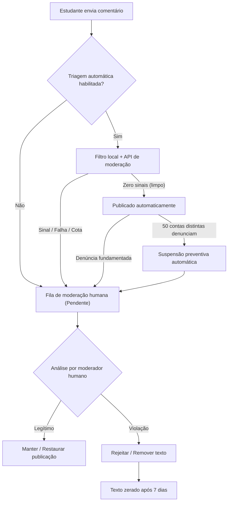

# Política de Moderação e Convivência — UnDb

> **Origem:** Consolidação das issues #263 e #264 (épico #272), aprovada pelo PO (Nicolas)
> em 17/11/2026 para a Release 2.
> O UnDb tem como missão dar transparência e contexto às decisões de matrícula dos estudantes da UnB,
> garantindo a livre circulação de relatos acadêmicos responsáveis em um ambiente seguro e respeitoso.

---

## 1. Princípios fundamentais

1. **Liberdade de crítica acadêmica legítima:** estudantes têm o direito de expressar experiências reais sobre a didática, métodos pedagógicos, pontualidade, ritmo de aulas e materiais de apoio de disciplinas cursadas na UnB.
2. **Vedação de ataques pessoais e ofensas:** críticas devem se concentrar no exercício docente e na experiência acadêmica, sendo expressamente proibidos xingamentos, ataques à honra, preconceito, assédio e ameaças.
3. **Ausência de veto institucional ou docente:** discordância do docente com uma avaliação, avaliações desfavoráveis ou impopularidade de turmas **não constituem motivo para remoção**.
4. **Independência das avaliações estruturadas:** a moderação atua exclusivamente sobre o texto livre opcional dos comentários. Decisões sobre texto **nunca alteram as notas numéricas** dos cinco critérios estruturados (didática, dificuldade, chamada, material e recomendação).
5. **Votos de utilidade não são denúncias:** eventuais votos de utilidade em comentários (#278) destinam-se exclusivamente à ordenação comunitária; **não acionam moderação** nem substituem o canal formal de denúncia.

---

## 2. Critérios de conteúdo: o que é permitido e o que é proibido

| Tema | Permitido (Crítica Acadêmica Legítima) | Proibido (Violação de Convivência) |
|---|---|---|
| **Didática e clareza** | “As explicações foram confusas para mim e o professor pulou etapas importantes na resolução de exercícios.” | “Professor incompetente e burro, deveria ser demitido imediatamente.” |
| **Ritmo e carga horária** | “O ritmo foi excessivamente rápido e a carga de trabalhos inviabilizou o acompanhamento com outras matérias.” | “Docente preguiçoso que não quer trabalhar.” |
| **Avaliação e critérios** | “As provas cobraram conteúdos não ensinados em aula e a correção foi excessivamente rígida.” | “Professor desonesto e ladrão de notas.” |
| **Material didático** | “Os slides tinham erros conceituais graves e o livro indicado estava esgotado na biblioteca.” | “Material imundo feito por um parasita.” |
| **Ambiente de sala de aula** | “O docente foi impaciente ao responder perguntas simples dos calouros.” | Qualquer ofensa discriminatória por motivo de raça, cor, etnia, gênero, orientação sexual, religião ou deficiência; assédio moral ou sexual; ameaças. |
| **Dados pessoais e privacidade** | Referências ao nome público docente conforme cadastrado no SIGAA da UnB. | Divulgação de número de telefone, endereço residencial, redes sociais pessoais, e-mail pessoal particular ou qualquer dado de terceiros e estudantes. |

---

## 3. Fluxo real de moderação

### 3.1 Triagem automática (quando habilitada)
- O sistema combina duas verificações complementares:
  1. **Filtro local:** identifica termos léxicos proibidos, caracteres homoglifos e substituições numéricas autorizadas;
  2. **API de moderação externa:** avalia categorias nativas de assédio, ódio e violência com `omni-moderation-latest`.
- **Publicação direta condicionada:** o comentário só é publicado imediatamente se ambas as checagens retornarem **zero sinais**.
- **Sem rejeição automática pela IA:** sinais de alerta, suspeita de exposição de dados, indisponibilidade do serviço ou limites de requisições **não reprovam** o texto: apenas o direcionam para o estado `pendente` para avaliação de um moderador humano.

### 3.2 Denúncias e limiar de suspensão
- Comentários publicados podem ser denunciados por qualquer pessoa autenticada ou visitante, mediante escolha de motivo estruturado obrigatório.
- **Uma única ocorrência fundamentada** é suficiente para análise por um moderador humano.
- O limiar de **50 contas autenticadas distintas** com denúncias abertas sobre a mesma versão funciona apenas como **gatilho de suspensão preventiva automática** da exibição pública, e nunca como um número mínimo para atendimento humano.

### 3.3 Julgamento humano e impedimentos
- A equipe de moderadores é designada pelo PO (Nicolas) entre os membros da equipe com conta confirmada.
- **Regra estrita de impedimento:** um moderador está expressamente proibido de julgar denúncias contra comentários de sua própria autoria ou casos em que ele mesmo seja o denunciante (RF22). Nesses casos, o julgamento é transferido a outro moderador elegível.
- A decisão motivada registra o motivo e a transição no banco interno de auditoria, com retenção máxima de 7 dias, após o qual o registro e o texto descartado são eliminados pela rotina periódica.

---

## 4. Revisão manual de decisões e atendimento a urgências

Qualquer autor ou solicitante que se sinta prejudicado por uma decisão de moderação (remoção de comentário ou manutenção de conteúdo contestado) pode solicitar **revisão manual** pelo canal existente.

### 4.1 Como solicitar revisão de moderação
1. Acesse o canal público em `/contato` (não exige login estudantil).
2. Consulte a solicitação original com **Protocolo** e **Chave secreta**.
3. No **Complemento**, informe a referência do comentário/decisão e explique por que pede revisão, com o contexto necessário e sem dados de terceiros desnecessários.
4. Um atendente verifica os impedimentos existentes e encaminha a revisão a moderador elegível, diferente de quem decidiu originalmente e de quem denunciou o caso. Se não houver pessoa elegível disponível, o pedido permanece para atendimento manual; não há julgamento automático.
5. A equipe registra internamente referência, justificativa, responsável elegível e providência em evento restrito. A resposta motivada é registrada como `RESPOSTA`; nomes de operadores e dados de denunciantes não são expostos ao solicitante.

### 4.2 Atendimento a urgências
- Casos de **exposição de dados pessoais**, vazamento de dados de contato ou ameaças podem ser reportados na categoria `EXPOSICAO_PESSOAL` em `/contato`, quando o recebimento estiver habilitado.
- A equipe disponível recebe urgências pelo canal privado que Nicolas confirmar e registrar em [canal de titulares](canal-titulares.md). Esse canal e a disponibilidade ainda não foram informados no repositório; enquanto não forem preenchidos, não é possível confirmar como a equipe será avisada. Não se promete intervenção imediata.
